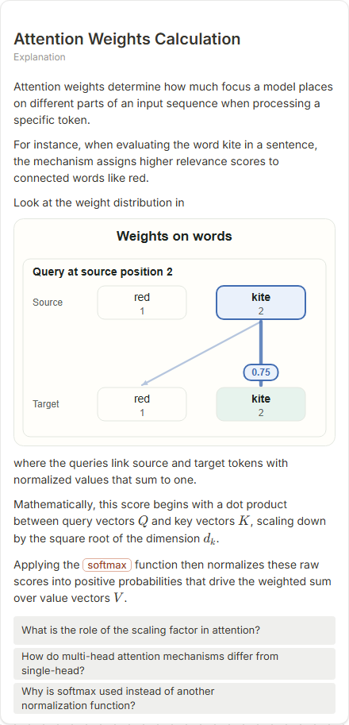

# Attention Weights Calculation

- Prompt: how are attention weights computed?
- Depth: balanced (balanced)
- Expected shape (owner): token-links: the heaviest weight's value on its link and a caption saying the weights sum to one; or a bar-chart of one query's weights
- Authored by: google / gemini-3.5-flash-lite
- Card as saved: 440 x 912 px at 100% zoom, KaTeX nodes 4 (errors 0)

## Body (as saved, visual markers in place)

Attention weights determine how much focus a model places on different parts of an input sequence when processing a specific token.

For instance, when evaluating the word kite in a sentence, the mechanism assigns higher relevance scores to connected words like red.

Look at the weight distribution in

[[visual:1]]

where the queries link source and target tokens with normalized values that sum to one.

Mathematically, this score begins with a dot product between query vectors $Q$ and key vectors $K$, scaling down by the square root of the dimension $d_k$.

Applying the softmax function then normalizes these raw scores into positive probabilities that drive the weighted sum over value vectors $V$.

## Visuals

- [[visual:1]] diagram, kind **token-links**, title "Weights on words", caption "" ([spec](visual-1.json), [svg](visual-1.svg), [png](visual-1.png))

## Follow-up questions

1. What is the role of the scaling factor in attention?
2. How do multi-head attention mechanisms differ from single-head?
3. Why is softmax used instead of another normalization function?

## Pipeline

- Planner (jev): visualType/plan visuals [{"type":"diagram","kind":"token-links"}], depthTreatment **mechanism**, kind **token-links** (fixed), confidence {"kind":0.79,"visualType":1}, flags {"needsPlot":0.81,"isPhysical":0.09,"needsWorkedExample":0.85}; per-kind probabilities are not in the server log (only the confidence of the chosen kind). secondVisual: not in this build.
- Visuals decided by: [{"winner":"plan","kinds":["token-links"],"wordHeuristics":"off"}]
- References selected: attempt 0: shape-token-links
- Model: profile google-low v1 (hash 7a65d850970c6aad); steps [{"provider":"google","model":"gemini-3.5-flash-lite","outcome":"artifact"}]; google/gemini-3.5-flash-lite reasoning effort low, author temperature = provider default (none sent), repair temperature 0.3, fallback fireworks gpt-oss-120b (used: no)
- Timing: planner 211 ms; model call(s) 2718 ms (sum 2718 ms); whole card 2967 ms
- Tokens (author + repair calls): input 3496, output 446; cost US$0.002164
- Repaired: no; attempts 1
- Server corrections: {"block.diagramCorrections":null,"explanation_diagram_corrected events":[],"visualFallback":null,"diagramsSimplified":null,"diagram smells logged":[]}
- Page errors while rendering: none
