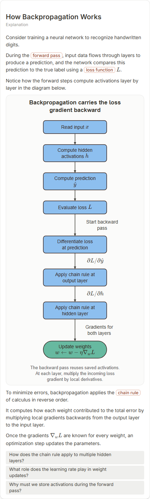

# How Backpropagation Works

- Prompt: how does backpropagation work?
- Depth: balanced (balanced)
- Expected shape (owner): flow or cycle: forward pass, loss, backward gradients, update; layers accepted
- Authored by: google / gemini-3.5-flash-lite
- Card as saved: 440 x 1453 px at 100% zoom, KaTeX nodes 9 (errors 0)

## Body (as saved, visual markers in place)

Consider training a neural network to recognize handwritten digits.

During the forward pass, input data flows through layers to produce a prediction, and the network compares this prediction to the true label using a loss function $L$.

Notice how the forward steps compute activations layer by layer in the diagram below.

[[visual:1]]

To minimize errors, backpropagation applies the chain rule of calculus in reverse order.

It computes how each weight contributed to the total error by multiplying local gradients backwards from the output layer to the input layer.

Once the gradients $\nabla_w L$ are known for every weight, an optimization step updates the parameters.

## Visuals

- [[visual:1]] diagram, kind **flow**, title "Backpropagation carries the loss gradient backward", caption "The backward pass reuses saved activations. At each layer, multiply the incoming loss gradient by local derivatives." ([spec](visual-1.json), [svg](visual-1.svg), [png](visual-1.png))

## Follow-up questions

1. How does the chain rule apply to multiple hidden layers?
2. What role does the learning rate play in weight updates?
3. Why must we store activations during the forward pass?

## Pipeline

- Planner (jev): visualType/plan visuals [{"type":"diagram","choose":["layers","flow"]}], depthTreatment **mechanism**, kind **layers** (two offered / not fixed), confidence {"kind":0.42,"visualType":1}, flags {"needsPlot":0.5,"isPhysical":0.08,"needsWorkedExample":0.83}; per-kind probabilities are not in the server log (only the confidence of the chosen kind). secondVisual: not in this build.
- Visuals decided by: [{"winner":"plan","kinds":["layers","flow"],"wordHeuristics":"off"}]
- References selected: attempt 0: shape-layers, ml-backpropagation
- Model: profile google-low v1 (hash 7a65d850970c6aad); steps [{"provider":"google","model":"gemini-3.5-flash-lite","outcome":"artifact"}]; google/gemini-3.5-flash-lite reasoning effort low, author temperature = provider default (none sent), repair temperature 0.3, fallback fireworks gpt-oss-120b (used: no)
- Timing: planner 125 ms; model call(s) 3183 ms (sum 3183 ms); whole card 3364 ms
- Tokens (author + repair calls): input 3829, output 966; cost US$0.003564
- Repaired: no; attempts 1
- Server corrections: {"block.diagramCorrections":null,"explanation_diagram_corrected events":[],"visualFallback":null,"diagramsSimplified":null,"diagram smells logged":[]}
- Page errors while rendering: none
