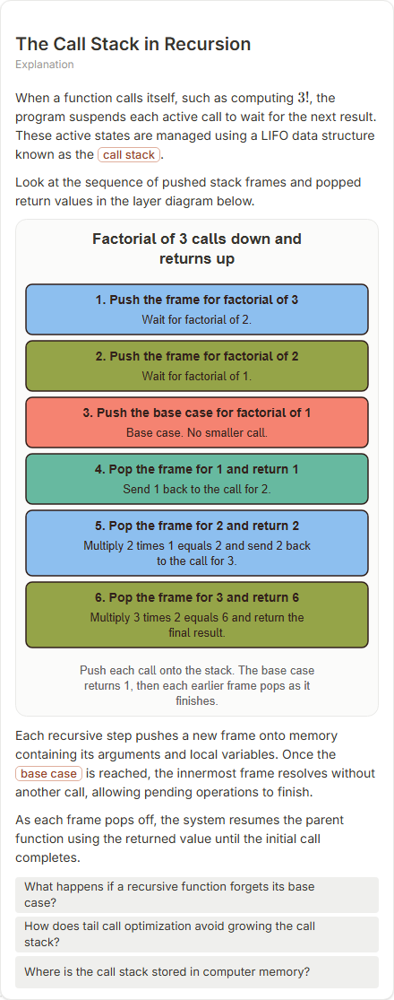

# The Call Stack in Recursion

- Prompt: how does the call stack work during recursion?
- Depth: balanced (balanced)
- Expected shape (owner): layers or horizontal block-stack: frames pushed and popped, the base case marked
- Authored by: google / gemini-3.5-flash-lite
- Card as saved: 440 x 1115 px at 100% zoom, KaTeX nodes 1 (errors 0)

## Body (as saved, visual markers in place)

When a function calls itself, such as computing $3!$, the program suspends each active call to wait for the next result. These active states are managed using a LIFO data structure known as the call stack.

Look at the sequence of pushed stack frames and popped return values in the layer diagram below.

[[visual:1]]

Each recursive step pushes a new frame onto memory containing its arguments and local variables. Once the base case is reached, the innermost frame resolves without another call, allowing pending operations to finish.

As each frame pops off, the system resumes the parent function using the returned value until the initial call completes.

## Visuals

- [[visual:1]] diagram, kind **layers**, title "Factorial of 3 calls down and returns up", caption "Push each call onto the stack. The base case returns 1, then each earlier frame pops as it finishes." ([spec](visual-1.json), [svg](visual-1.svg), [png](visual-1.png))

## Follow-up questions

1. What happens if a recursive function forgets its base case?
2. How does tail call optimization avoid growing the call stack?
3. Where is the call stack stored in computer memory?

## Pipeline

- Planner (jev): visualType/plan visuals [{"type":"diagram","kind":"layers"}], depthTreatment **mechanism**, kind **layers** (fixed), confidence {"kind":0.96,"visualType":1}, flags {"needsPlot":0.1,"isPhysical":0.1,"needsWorkedExample":0.81}; per-kind probabilities are not in the server log (only the confidence of the chosen kind). secondVisual: not in this build.
- Visuals decided by: [{"winner":"plan","kinds":["layers"],"wordHeuristics":"off"}]
- References selected: attempt 0: shape-layers, recursion-factorial-unwind
- Model: profile google-low v1 (hash 7a65d850970c6aad); steps [{"provider":"google","model":"gemini-3.5-flash-lite","outcome":"artifact"}]; google/gemini-3.5-flash-lite reasoning effort low, author temperature = provider default (none sent), repair temperature 0.3, fallback fireworks gpt-oss-120b (used: no)
- Timing: planner 97 ms; model call(s) 2559 ms (sum 2559 ms); whole card 2704 ms
- Tokens (author + repair calls): input 3757, output 671; cost US$0.002805
- Repaired: no; attempts 1
- Server corrections: {"block.diagramCorrections":null,"explanation_diagram_corrected events":[],"visualFallback":null,"diagramsSimplified":null,"diagram smells logged":[]}
- Page errors while rendering: none
