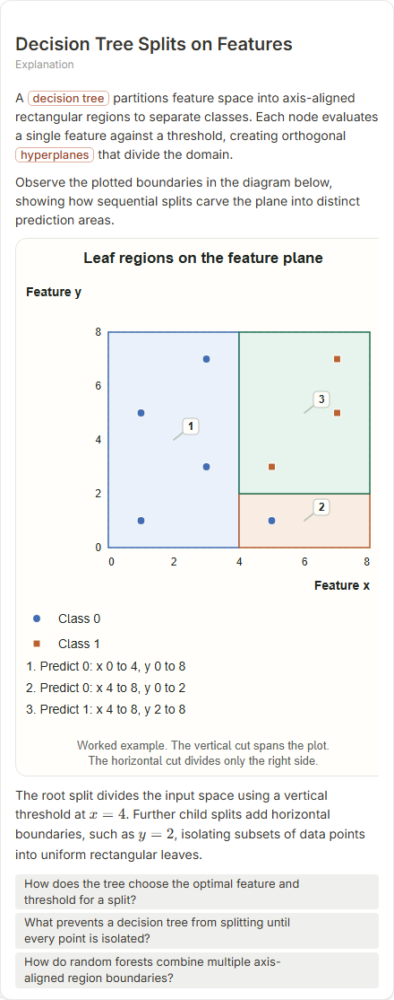
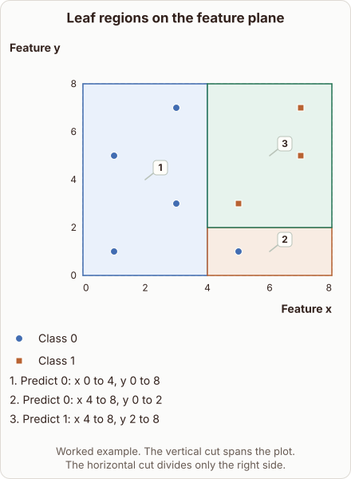
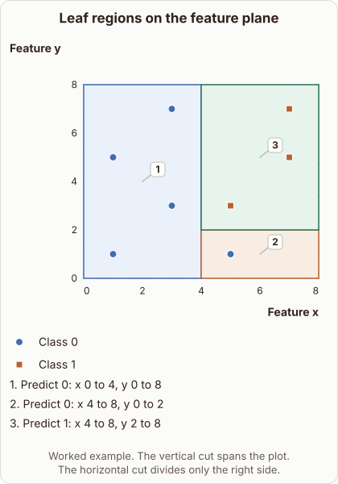

# Decision Tree Splits on Features

- Prompt: how does a decision tree split a two-feature dataset into regions?
- Depth: Balanced (bench key standard)
- Expected reference: ml-trees-decision-regions; expected kind: coordinate-plot
- Sent bare: only the prompt (no lesson, no context, no selection); depth standard
- Selector hit (expected reference among the references sent to the author): yes; first pick (expected reference sent first): no
- References sent to the author (attempt 0, selector order): shape-coordinate-plot, ml-trees-decision-regions
- Steer (explanation_plan_kind_from_reference): no (event absent)
- Planner kind: coordinate-plot (fixed); planner kind = expected: yes
- Model kind (first diagram): coordinate-plot; all visuals: coordinate-plot; model kind = expected: yes
- Picture routing: planner pictures 0; pictures in the card 0; dropped none
- Repaired: no; visual fallback: no; server corrections: null
- Authored by google / gemini-3.5-flash-lite
- Time 3566 ms (model call(s) 3295 ms); tokens in/out 3901/864; cost US$0.003331
- Factual (factual-v2): 5/5, error no

| model (440 px) | reference (408 px) |
|---|---|
|  |  |

## Body (as saved, visual markers in place)

A decision tree partitions feature space into axis-aligned rectangular regions to separate classes. Each node evaluates a single feature against a threshold, creating orthogonal hyperplanes that divide the domain.

Observe the plotted boundaries in the diagram below, showing how sequential splits carve the plane into distinct prediction areas.

[[visual:1]]

The root split divides the input space using a vertical threshold at $x = 4$. Further child splits add horizontal boundaries, such as $y = 2$, isolating subsets of data points into uniform rectangular leaves.

## Visuals

- [[visual:1]] diagram, kind **coordinate-plot**, title "Leaf regions on the feature plane", caption "Worked example. The vertical cut spans the plot. The horizontal cut divides only the right side." ([spec](visual-1.json), [svg](visual-1.svg), [png](visual-1.png))

## Follow-up questions

1. How does the tree choose the optimal feature and threshold for a split?
2. What prevents a decision tree from splitting until every point is isolated?
3. How do random forests combine multiple axis-aligned region boundaries?
