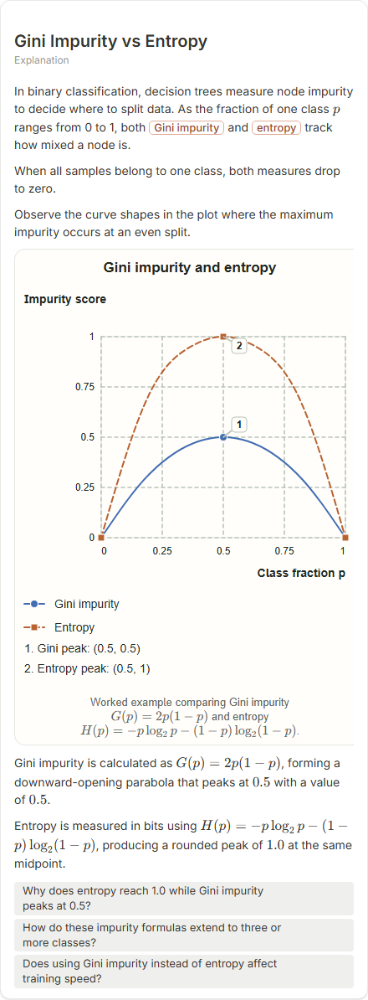
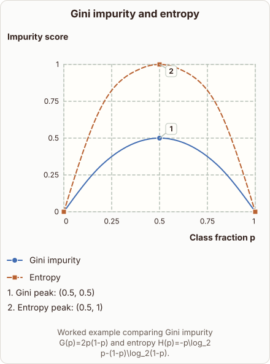
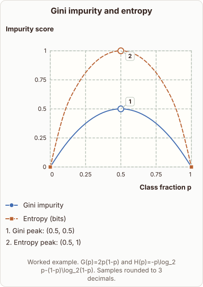

# Gini Impurity vs Entropy

- Prompt: how does Gini impurity change as the fraction of one class goes from 0 to 1, compared with entropy?
- Depth: Balanced (bench key standard)
- Expected reference: ml-trees-gini-vs-entropy; expected kind: coordinate-plot
- Sent bare: only the prompt (no lesson, no context, no selection); depth standard
- Selector hit (expected reference among the references sent to the author): yes; first pick (expected reference sent first): no
- References sent to the author (attempt 0, selector order): shape-coordinate-plot, ml-trees-gini-vs-entropy
- Steer (explanation_plan_kind_from_reference): no (event absent)
- Planner kind: coordinate-plot (fixed); planner kind = expected: yes
- Model kind (first diagram): coordinate-plot; all visuals: coordinate-plot; model kind = expected: yes
- Picture routing: planner pictures 0; pictures in the card 0; dropped none
- Repaired: no; visual fallback: no; server corrections: null
- Authored by google / gemini-3.5-flash-lite
- Time 5135 ms (model call(s) 4126 ms); tokens in/out 3983/1038; cost US$0.00379
- Factual (factual-v2): 5/5, error no

| model (440 px) | reference (408 px) |
|---|---|
|  |  |

## Body (as saved, visual markers in place)

In binary classification, decision trees measure node impurity to decide where to split data. As the fraction of one class $p$ ranges from 0 to 1, both Gini impurity and entropy track how mixed a node is.

When all samples belong to one class, both measures drop to zero.

Observe the curve shapes in the plot where the maximum impurity occurs at an even split.

[[visual:1]]

Gini impurity is calculated as $G(p) = 2p(1-p)$, forming a downward-opening parabola that peaks at $0.5$ with a value of $0.5$.

Entropy is measured in bits using $H(p) = -p\log_2 p - (1-p)\log_2(1-p)$, producing a rounded peak of $1.0$ at the same midpoint.

## Visuals

- [[visual:1]] diagram, kind **coordinate-plot**, title "Gini impurity and entropy", caption "Worked example comparing Gini impurity $G(p)=2p(1-p)$ and entropy $H(p)=-p\log_2 p-(1-p)\log_2(1-p)$." ([spec](visual-1.json), [svg](visual-1.svg), [png](visual-1.png))

## Follow-up questions

1. Why does entropy reach 1.0 while Gini impurity peaks at 0.5?
2. How do these impurity formulas extend to three or more classes?
3. Does using Gini impurity instead of entropy affect training speed?
