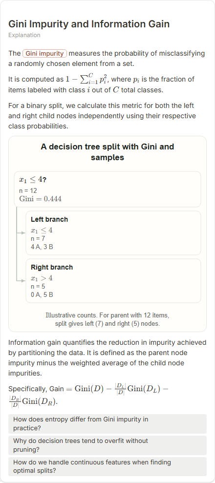
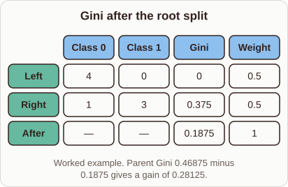

# Gini Impurity and Information Gain

- Prompt: how do I compute the Gini impurity on both sides of a split and the information gain?
- Depth: Detailed (bench key deep)
- Expected reference: ml-trees-gini-split-detailed; expected kind: matrix
- Selector hit (expected reference among the references sent to the author): no; first pick (expected reference sent first): no
- References sent to the author (attempt 0, selector order): shape-tree, ml-tree-split-path
- Planner kind: tree (fixed); planner kind = expected: no
- Model kind (first diagram): tree; all visuals: tree; model kind = expected: no
- Picture routing: planner pictures 0; pictures in the card 0; dropped none
- Repaired: no; visual fallback: no; server corrections: null
- Authored by google / gemini-3.5-flash-lite
- Time 4105 ms (model call(s) 3461 ms); tokens in/out 3933/746; cost US$0.003045
- Factual (factual-v2): 5/5, error no

| model (440 px) | reference (408 px) |
|---|---|
|  |  |

## Body (as saved, visual markers in place)

The Gini impurity measures the probability of misclassifying a randomly chosen element from a set.

It is computed as $1 - \sum_{i=1}^{C} p_i^2$, where $p_i$ is the fraction of items labeled with class $i$ out of $C$ total classes.

For a binary split, we calculate this metric for both the left and right child nodes independently using their respective class probabilities.

[[visual:1]]

Information gain quantifies the reduction in impurity achieved by partitioning the data. It is defined as the parent node impurity minus the weighted average of the child node impurities.

Specifically, Gain $= \text{Gini}(D) - \frac{|D_L|}{|D|} \text{Gini}(D_L) - \frac{|D_R|}{|D|} \text{Gini}(D_R)$.

## Visuals

- [[visual:1]] diagram, kind **tree**, title "A decision tree split with Gini and samples", caption "Illustrative counts. For parent with 12 items, split gives left (7) and right (5) nodes." ([spec](visual-1.json), [svg](visual-1.svg), [png](visual-1.png))

## Follow-up questions

1. How does entropy differ from Gini impurity in practice?
2. Why do decision trees tend to overfit without pruning?
3. How do we handle continuous features when finding optimal splits?
