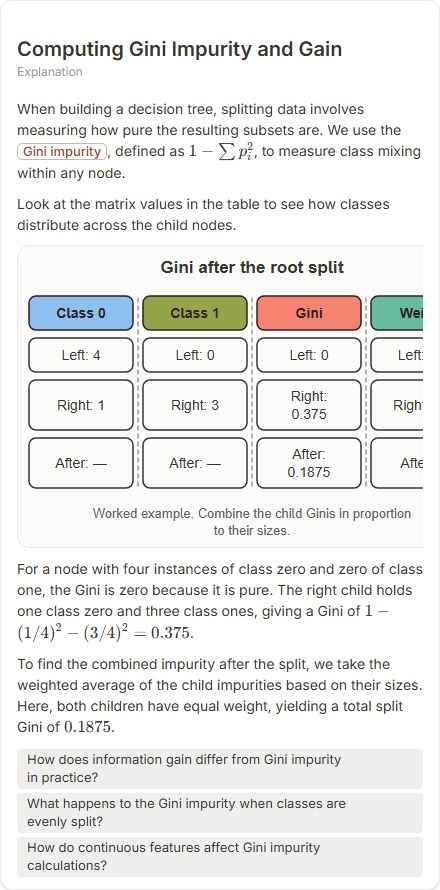
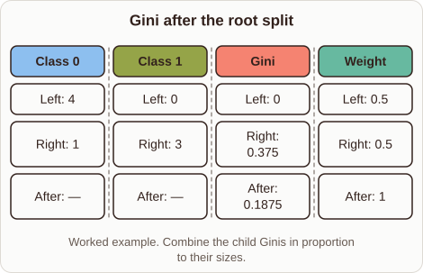
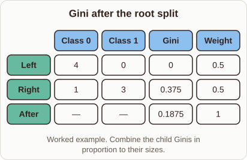

# Computing Gini Impurity and Gain

- Prompt: how do I compute the Gini impurity on both sides of a split and the information gain?
- Depth: Balanced (bench key standard)
- Expected reference: ml-trees-gini-split; expected kind: matrix
- Sent bare: only the prompt (no lesson, no context, no selection); depth standard
- Selector hit (expected reference among the references sent to the author): yes; first pick (expected reference sent first): no
- References sent to the author (attempt 0, selector order): shape-matrix, ml-trees-gini-split
- Steer (explanation_plan_kind_from_reference): plannerKind tree, reference ml-trees-gini-split, referenceKind matrix, steerSource reference, score 50
- Planner kind: matrix (fixed); planner kind = expected: yes
- Model kind (first diagram): comparison; all visuals: comparison; model kind = expected: no
- Picture routing: planner pictures 0; pictures in the card 0; dropped none
- Repaired: yes; cause (first attempt error): attempt 0: explanation_bad_diagram: the rh-diagram spec is not valid (diagram.columns.0: Invalid input: expected string, received object; diagram.columns.1: Invalid input: expected string, received object; diagram.columns.2: Invalid input: expected st; visual fallback: "simplified"; server corrections: {"simplified_comparison":1}
- Authored by google / gemini-3.5-flash-lite
- Time 5989 ms (model call(s) 2994 + 2790 ms); tokens in/out 7844/1294; cost US$0.005589
- Factual (factual-v2): 5/5, error no

| model (440 px) | reference (408 px) |
|---|---|
|  |  |

## Body (as saved, visual markers in place)

When building a decision tree, splitting data involves measuring how pure the resulting subsets are. We use the Gini impurity, defined as $1 - \sum p_i^2$, to measure class mixing within any node.

Look at the matrix values in the table to see how classes distribute across the child nodes.

[[visual:1]]

For a node with four instances of class zero and zero of class one, the Gini is zero because it is pure. The right child holds one class zero and three class ones, giving a Gini of $1 - (1/4)^2 - (3/4)^2 = 0.375$.

To find the combined impurity after the split, we take the weighted average of the child impurities based on their sizes. Here, both children have equal weight, yielding a total split Gini of $0.1875$.

## Visuals

- [[visual:1]] diagram, kind **comparison**, title "Gini after the root split", caption "Worked example. Combine the child Ginis in proportion to their sizes." ([spec](visual-1.json), [svg](visual-1.svg), [png](visual-1.png))

## Follow-up questions

1. How does information gain differ from Gini impurity in practice?
2. What happens to the Gini impurity when classes are evenly split?
3. How do continuous features affect Gini impurity calculations?
