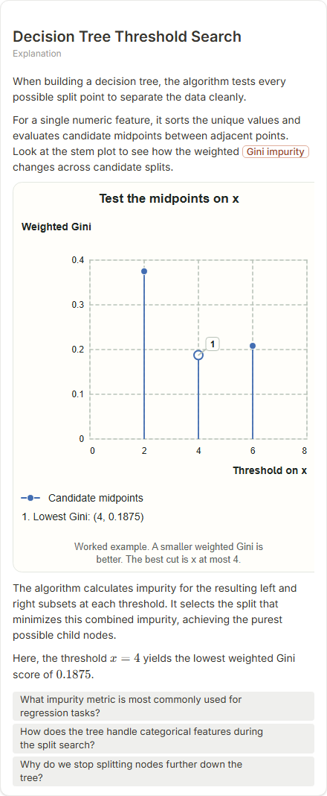
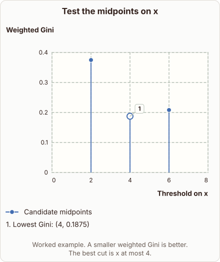
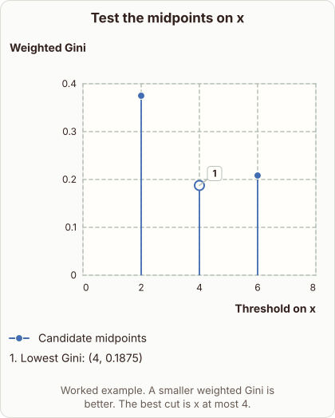

# Decision Tree Threshold Search

- Prompt: how does a decision tree search for the best threshold on one feature?
- Depth: Balanced (bench key standard)
- Expected reference: ml-trees-threshold-search; expected kind: coordinate-plot
- Sent bare: only the prompt (no lesson, no context, no selection); depth standard
- Selector hit (expected reference among the references sent to the author): yes; first pick (expected reference sent first): no
- References sent to the author (attempt 0, selector order): shape-coordinate-plot, ml-trees-threshold-search, sigmoid-threshold
- Steer (explanation_plan_kind_from_reference): no (event absent)
- Planner kind: coordinate-plot (not fixed; offered coordinate-plot | number-line); planner kind = expected: yes
- Model kind (first diagram): coordinate-plot; all visuals: coordinate-plot; model kind = expected: yes
- Picture routing: planner pictures 0; pictures in the card 0; dropped none
- Repaired: no; visual fallback: no; server corrections: null
- Authored by google / gemini-3.5-flash-lite
- Time 3176 ms (model call(s) 2926 ms); tokens in/out 4085/627; cost US$0.002793
- Factual (factual-v2): 4/5, error no - Minor: 'purest possible child nodes' slightly overstates a greedy weighted-impurity minimum; the numeric claim is plausible but unverifiable.

| model (440 px) | reference (408 px) |
|---|---|
|  |  |

## Body (as saved, visual markers in place)

When building a decision tree, the algorithm tests every possible split point to separate the data cleanly.

For a single numeric feature, it sorts the unique values and evaluates candidate midpoints between adjacent points. Look at the stem plot to see how the weighted Gini impurity changes across candidate splits.

[[visual:1]]

The algorithm calculates impurity for the resulting left and right subsets at each threshold. It selects the split that minimizes this combined impurity, achieving the purest possible child nodes.

Here, the threshold $x = 4$ yields the lowest weighted Gini score of $0.1875$.

## Visuals

- [[visual:1]] diagram, kind **coordinate-plot**, title "Test the midpoints on x", caption "Worked example. A smaller weighted Gini is better. The best cut is x at most 4." ([spec](visual-1.json), [svg](visual-1.svg), [png](visual-1.png))

## Follow-up questions

1. What impurity metric is most commonly used for regression tasks?
2. How does the tree handle categorical features during the split search?
3. Why do we stop splitting nodes further down the tree?
