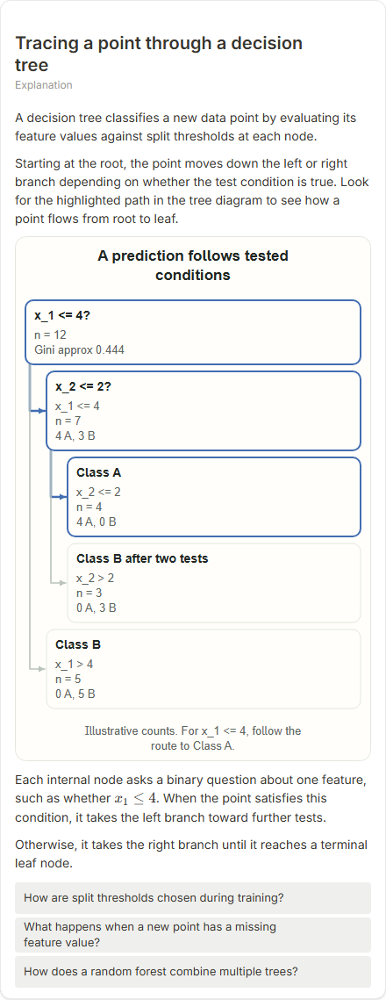
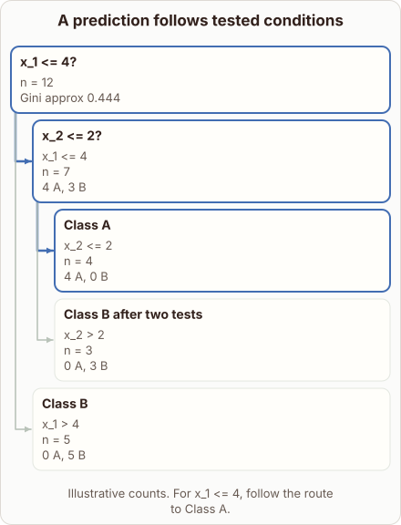
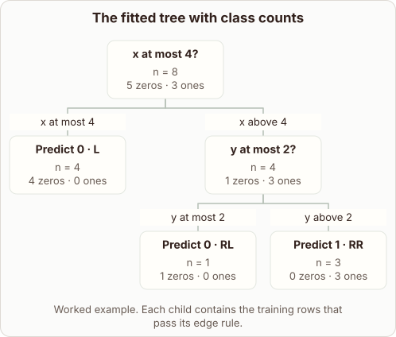

# Tracing a point through a decision tree

- Prompt: how does a decision tree trace a new point from the root to a prediction?
- Depth: Balanced (bench key standard)
- Expected reference: ml-trees-grown-tree; expected kind: tree
- Sent bare: only the prompt (no lesson, no context, no selection); depth standard
- Selector hit (expected reference among the references sent to the author): yes; first pick (expected reference sent first): no
- References sent to the author (attempt 0, selector order): shape-tree, ml-trees-grown-tree, ml-tree-split-path
- Steer (explanation_plan_kind_from_reference): no (event absent)
- Planner kind: tree (fixed); planner kind = expected: yes
- Model kind (first diagram): tree; all visuals: tree; model kind = expected: yes
- Picture routing: planner pictures 0; pictures in the card 0; dropped none
- Repaired: no; visual fallback: no; server corrections: null
- Authored by google / gemini-3.5-flash-lite
- Time 3070 ms (model call(s) 2516 ms); tokens in/out 4111/484; cost US$0.002444
- Factual (factual-v2): 4/5, error no - The prose is accurate. The diagram text is slightly ambiguous: it mentions both a route to Class A and 'Class B after two tests', but this is not a clear factual error.

| model (440 px) | reference (408 px) |
|---|---|
|  |  |

## Body (as saved, visual markers in place)

A decision tree classifies a new data point by evaluating its feature values against split thresholds at each node.

Starting at the root, the point moves down the left or right branch depending on whether the test condition is true. Look for the highlighted path in the tree diagram to see how a point flows from root to leaf.

[[visual:1]]

Each internal node asks a binary question about one feature, such as whether $x_1 \le 4$. When the point satisfies this condition, it takes the left branch toward further tests.

Otherwise, it takes the right branch until it reaches a terminal leaf node.

## Visuals

- [[visual:1]] diagram, kind **tree**, title "A prediction follows tested conditions", caption "Illustrative counts. For x_1 <= 4, follow the route to Class A." ([spec](visual-1.json), [svg](visual-1.svg), [png](visual-1.png))

## Follow-up questions

1. How are split thresholds chosen during training?
2. What happens when a new point has a missing feature value?
3. How does a random forest combine multiple trees?
