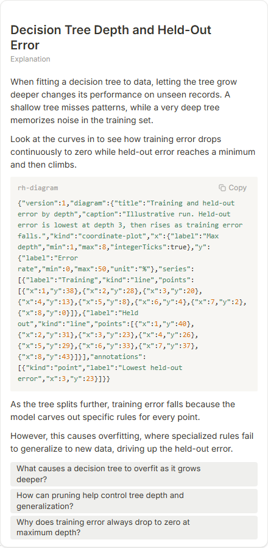
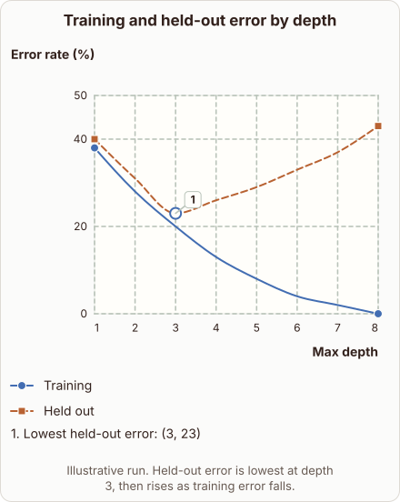
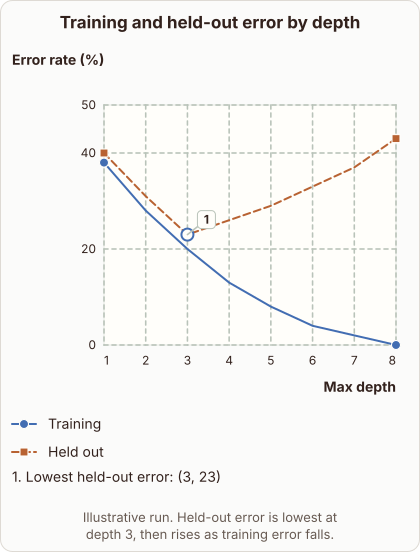

# Decision Tree Depth and Held-Out Error

- Prompt: how does held-out error change as a decision tree grows deeper?
- Depth: Balanced (bench key standard)
- Expected reference: ml-trees-depth-overfit; expected kind: coordinate-plot
- Sent bare: only the prompt (no lesson, no context, no selection); depth standard
- Selector hit (expected reference among the references sent to the author): yes; first pick (expected reference sent first): no
- References sent to the author (attempt 0, selector order): shape-coordinate-plot, ml-trees-depth-overfit
- Steer (explanation_plan_kind_from_reference): no (event absent)
- Planner kind: coordinate-plot (fixed); planner kind = expected: yes
- Model kind (first diagram): coordinate-plot; all visuals: coordinate-plot; model kind = expected: yes
- Picture routing: planner pictures 0; pictures in the card 0; dropped none
- Repaired: no; visual fallback: no; server corrections: null
- Authored by google / gemini-3.5-flash-lite
- Time 3550 ms (model call(s) 3307 ms); tokens in/out 3935/800; cost US$0.003181
- Factual (factual-v2): 4/5, error no - Minor simplification: training error reaches zero only if no conflicting duplicate records; held-out error often plateaus rather than strictly climbing.

| model (440 px) | reference (408 px) |
|---|---|
|  |  |

## Body (as saved, visual markers in place)

When fitting a decision tree to data, letting the tree grow deeper changes its performance on unseen records. A shallow tree misses patterns, while a very deep tree memorizes noise in the training set.

Look at the curves in to see how training error drops continuously to zero while held-out error reaches a minimum and then climbs.

[[visual:1]]

As the tree splits further, training error falls because the model carves out specific rules for every point.

However, this causes overfitting, where specialized rules fail to generalize to new data, driving up the held-out error.

## Visuals

- [[visual:1]] diagram, kind **coordinate-plot**, title "Training and held-out error by depth", caption "Illustrative run. Held-out error is lowest at depth 3, then rises as training error falls." ([spec](visual-1.json), [svg](visual-1.svg), [png](visual-1.png))

## Follow-up questions

1. What causes a decision tree to overfit as it grows deeper?
2. How can pruning help control tree depth and generalization?
3. Why does training error always drop to zero at maximum depth?
