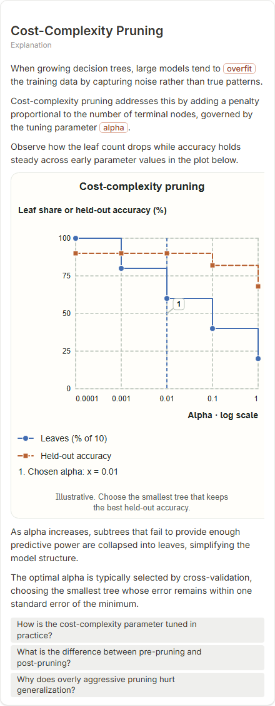
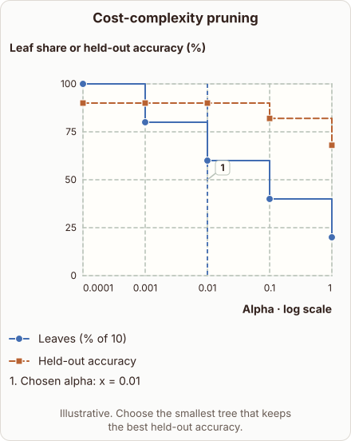
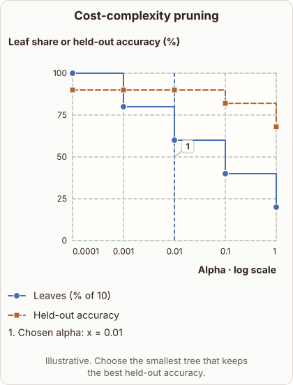

# Cost-Complexity Pruning

- Prompt: how does cost-complexity pruning trade tree size against accuracy as alpha increases?
- Depth: Balanced (bench key standard)
- Expected reference: ml-trees-cost-complexity-pruning; expected kind: coordinate-plot
- Sent bare: only the prompt (no lesson, no context, no selection); depth standard
- Selector hit (expected reference among the references sent to the author): yes; first pick (expected reference sent first): no
- References sent to the author (attempt 0, selector order): shape-coordinate-plot, ml-trees-cost-complexity-pruning
- Steer (explanation_plan_kind_from_reference): no (event absent)
- Planner kind: coordinate-plot (fixed); planner kind = expected: yes
- Model kind (first diagram): coordinate-plot; all visuals: coordinate-plot; model kind = expected: yes
- Picture routing: planner pictures 0; pictures in the card 0; dropped none
- Repaired: no; visual fallback: no; server corrections: null
- Authored by google / gemini-3.5-flash-lite
- Time 3595 ms (model call(s) 3310 ms); tokens in/out 3926/862; cost US$0.003333
- Factual (factual-v2): 4/5, error no - The content is accurate. Cost-complexity pruning penalizes the number of terminal nodes via alpha, and larger alpha collapses weak subtrees. Cross-validation with the one-standard-error rule is standard. The diagram description says 'smallest tree that keeps the best held-out accuracy', a slight simplification of the 1-SE rule, which is acceptable.

| model (440 px) | reference (408 px) |
|---|---|
|  |  |

## Body (as saved, visual markers in place)

When growing decision trees, large models tend to overfit the training data by capturing noise rather than true patterns.

Cost-complexity pruning addresses this by adding a penalty proportional to the number of terminal nodes, governed by the tuning parameter alpha.

Observe how the leaf count drops while accuracy holds steady across early parameter values in the plot below.

[[visual:1]]

As alpha increases, subtrees that fail to provide enough predictive power are collapsed into leaves, simplifying the model structure.

The optimal alpha is typically selected by cross-validation, choosing the smallest tree whose error remains within one standard error of the minimum.

## Visuals

- [[visual:1]] diagram, kind **coordinate-plot**, title "Cost-complexity pruning", caption "Illustrative. Choose the smallest tree that keeps the best held-out accuracy." ([spec](visual-1.json), [svg](visual-1.svg), [png](visual-1.png))

## Follow-up questions

1. How is the cost-complexity parameter tuned in practice?
2. What is the difference between pre-pruning and post-pruning?
3. Why does overly aggressive pruning hurt generalization?
