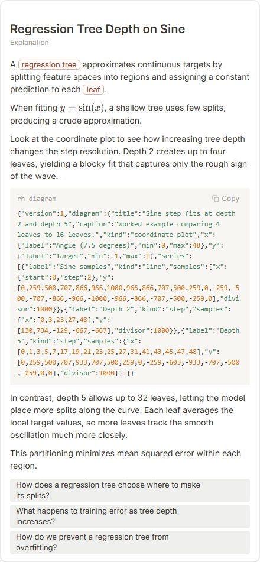
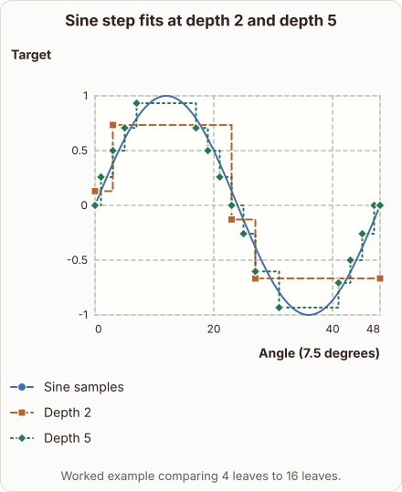
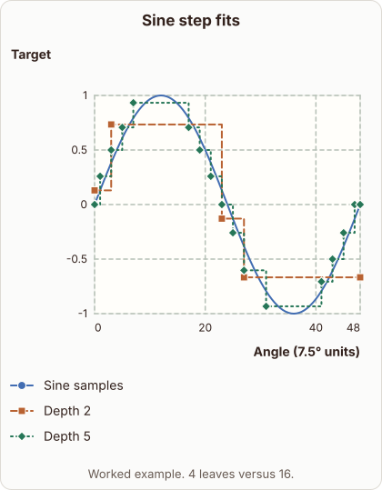

# Regression Tree Depth on Sine

- Prompt: how does a regression tree fit y = sin(x) with a step function at depth 2 versus depth 5?
- Depth: Balanced (bench key standard)
- Expected reference: ml-trees-regression-step-fit; expected kind: coordinate-plot
- Sent bare: only the prompt (no lesson, no context, no selection); depth standard
- Selector hit (expected reference among the references sent to the author): yes; first pick (expected reference sent first): no
- References sent to the author (attempt 0, selector order): shape-coordinate-plot, ml-trees-regression-step-fit, regression-tree-steps
- Steer (explanation_plan_kind_from_reference): no (event absent)
- Planner kind: coordinate-plot (fixed); planner kind = expected: yes
- Model kind (first diagram): coordinate-plot; all visuals: coordinate-plot; model kind = expected: yes
- Picture routing: planner pictures 0; pictures in the card 0; dropped none
- Repaired: no; visual fallback: no; server corrections: null
- Authored by google / gemini-3.5-flash-lite
- Time 4624 ms (model call(s) 3904 ms); tokens in/out 4241/997; cost US$0.003765
- Factual (factual-v2): 3/5, error yes - Diagram says depth 5 corresponds to 16 leaves, but depth 5 allows up to 32 leaves (16 is depth 4), contradicting the prose.

| model (440 px) | reference (408 px) |
|---|---|
|  |  |

## Body (as saved, visual markers in place)

A regression tree approximates continuous targets by splitting feature spaces into regions and assigning a constant prediction to each leaf.

When fitting $y = \sin(x)$, a shallow tree uses few splits, producing a crude approximation.

Look at the coordinate plot to see how increasing tree depth changes the step resolution. Depth 2 creates up to four leaves, yielding a blocky fit that captures only the rough sign of the wave.

[[visual:1]]

In contrast, depth 5 allows up to 32 leaves, letting the model place more splits along the curve. Each leaf averages the local target values, so more leaves track the smooth oscillation much more closely.

This partitioning minimizes mean squared error within each region.

## Visuals

- [[visual:1]] diagram, kind **coordinate-plot**, title "Sine step fits at depth 2 and depth 5", caption "Worked example comparing 4 leaves to 16 leaves." ([spec](visual-1.json), [svg](visual-1.svg), [png](visual-1.png))

## Follow-up questions

1. How does a regression tree choose where to make its splits?
2. What happens to training error as tree depth increases?
3. How do we prevent a regression tree from overfitting?
