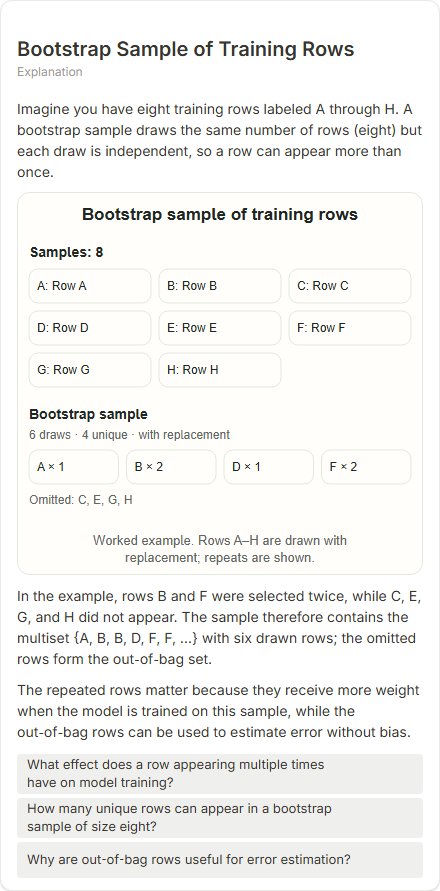
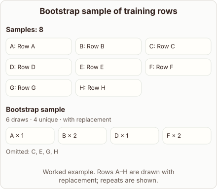
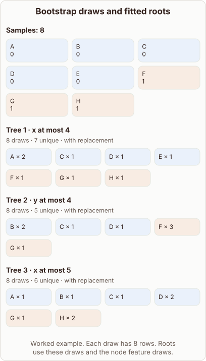

# Bootstrap Sample of Training Rows

- Prompt: what does a bootstrap sample of the training rows look like, and which rows repeat?
- Depth: Balanced (bench key standard)
- Expected reference: ml-trees-bootstrap-roots; expected kind: sample-set
- Selector hit (expected reference among the references sent to the author): yes; first pick (expected reference sent first): no
- References sent to the author (attempt 0, selector order): shape-sample-set, ml-trees-bootstrap-roots, bootstrap-replacement-oob
- Planner kind: sample-set (fixed); planner kind = expected: yes
- Model kind (first diagram): sample-set; all visuals: sample-set; model kind = expected: yes
- Picture routing: planner pictures 0; pictures in the card 0; dropped none
- Repaired: yes (other: explanation_bad_diagram: the rh-diagram spec is not valid (diagram.samples: Invalid input: expected , visual marker / layout); visual fallback: no; server corrections: null
- Authored by fireworks / accounts/fireworks/models/gpt-oss-120b
- Time 9668 ms (model call(s) 2926 + 2231 + 3822 ms); tokens in/out 17018/1442; cost US$0.006483
- Factual (factual-v2): 2/5, error yes - Example is inconsistent: a bootstrap sample of 8 draws is described as 6 rows, and the diagram lists C, E, G, H in the sample though the prose says they were omitted; OOB error is also only approximately unbiased.

| model (440 px) | reference (408 px) |
|---|---|
|  |  |

## Body (as saved, visual markers in place)

Imagine you have eight training rows labeled A through H. A bootstrap sample draws the same number of rows (eight) but each draw is independent, so a row can appear more than once.

[[visual:1]]

In the example, rows B and F were selected twice, while C, E, G, and H did not appear. The sample therefore contains the multiset {A, B, B, D, F, F, …} with six drawn rows; the omitted rows form the out‑of‑bag set.

The repeated rows matter because they receive more weight when the model is trained on this sample, while the out‑of‑bag rows can be used to estimate error without bias.

## Visuals

- [[visual:1]] diagram, kind **sample-set**, title "Bootstrap sample of training rows", caption "Worked example. Rows A–H are drawn with replacement; repeats are shown." ([spec](visual-1.json), [svg](visual-1.svg), [png](visual-1.png))

## Follow-up questions

1. What effect does a row appearing multiple times have on model training?
2. How many unique rows can appear in a bootstrap sample of size eight?
3. Why are out‑of‑bag rows useful for error estimation?
