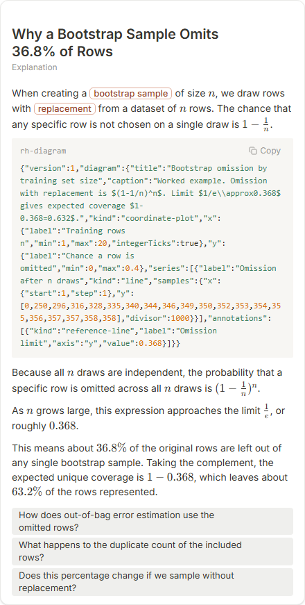
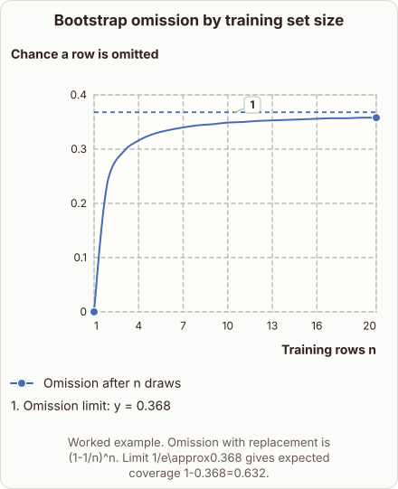
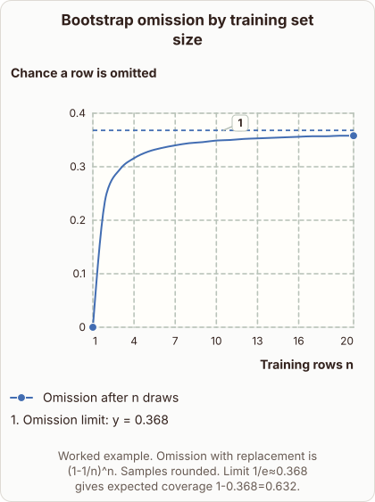

# Why a Bootstrap Sample Omits 36.8% of Rows

- Prompt: why does a bootstrap sample contain only about 63% of the unique training rows?
- Depth: Balanced (bench key standard)
- Expected reference: ml-trees-bootstrap-coverage; expected kind: coordinate-plot
- Sent bare: only the prompt (no lesson, no context, no selection); depth standard
- Selector hit (expected reference among the references sent to the author): yes; first pick (expected reference sent first): no
- References sent to the author (attempt 0, selector order): shape-coordinate-plot, ml-trees-bootstrap-coverage
- Steer (explanation_plan_kind_from_reference): plannerKind sample-set, reference ml-trees-bootstrap-coverage, referenceKind coordinate-plot, steerSource reference, score 50
- Planner kind: coordinate-plot (fixed); planner kind = expected: yes
- Model kind (first diagram): coordinate-plot; all visuals: coordinate-plot; model kind = expected: yes
- Picture routing: planner pictures 0; pictures in the card 0; dropped none
- Repaired: no; visual fallback: no; server corrections: null
- Authored by google / gemini-3.5-flash-lite
- Time 5814 ms (model call(s) 5624 ms); tokens in/out 3917/833; cost US$0.003258
- Factual (factual-v2): 5/5, error no

| model (440 px) | reference (408 px) |
|---|---|
|  |  |

## Body (as saved, visual markers in place)

When creating a bootstrap sample of size $n$, we draw rows with replacement from a dataset of $n$ rows. The chance that any specific row is not chosen on a single draw is $1 - \frac{1}{n}$.

[[visual:1]]

Because all $n$ draws are independent, the probability that a specific row is omitted across all $n$ draws is $(1 - \frac{1}{n})^n$.

As $n$ grows large, this expression approaches the limit $\frac{1}{e}$, or roughly $0.368$.

This means about $36.8\%$ of the original rows are left out of any single bootstrap sample. Taking the complement, the expected unique coverage is $1 - 0.368$, which leaves about $63.2\%$ of the rows represented.

## Visuals

- [[visual:1]] diagram, kind **coordinate-plot**, title "Bootstrap omission by training set size", caption "Worked example. Omission with replacement is $(1-1/n)^n$. Limit $1/e\approx0.368$ gives expected coverage $1-0.368=0.632$." ([spec](visual-1.json), [svg](visual-1.svg), [png](visual-1.png))

## Follow-up questions

1. How does out-of-bag error estimation use the omitted rows?
2. What happens to the duplicate count of the included rows?
3. Does this percentage change if we sample without replacement?
