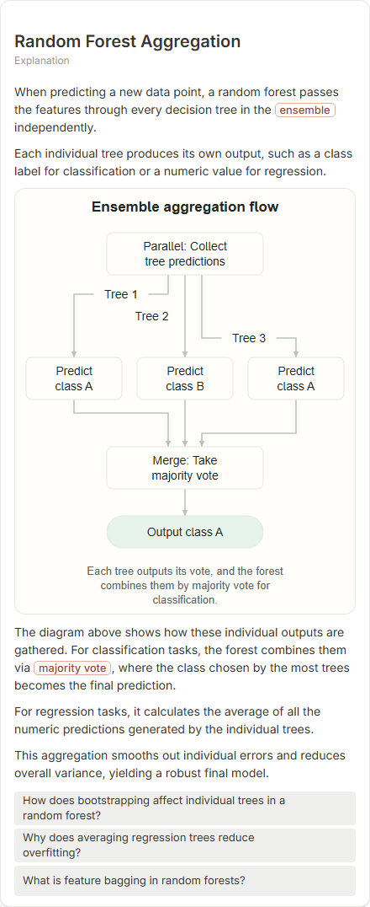
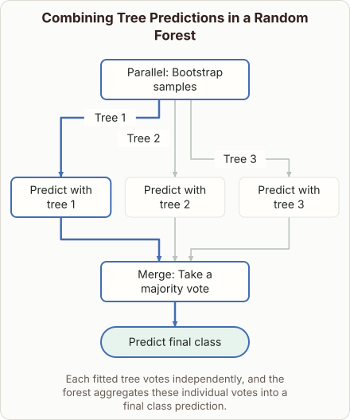
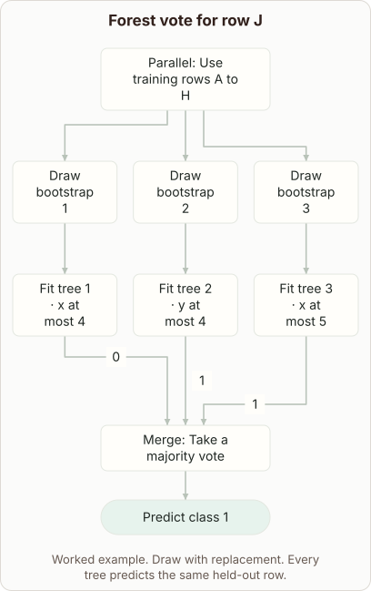

# Random Forest Aggregation

- Prompt: how does a random forest combine the predictions of its trees into one answer?
- Depth: Balanced (bench key standard)
- Expected reference: ml-trees-majority-vote; expected kind: bar-chart
- Selector hit (expected reference among the references sent to the author): no; first pick (expected reference sent first): no
- References sent to the author (attempt 0, selector order): shape-flow, ml-bagging-vote-flow
- Planner kind: flow (not fixed; offered flow | tree); planner kind = expected: no
- Model kind (first diagram): flow; all visuals: flow; model kind = expected: no
- Picture routing: planner pictures 0; pictures in the card 0; dropped none
- Repaired: no; visual fallback: no; server corrections: null
- Authored by google / gemini-3.5-flash-lite
- Time 3885 ms (model call(s) 3213 ms); tokens in/out 3805/779; cost US$0.003089
- Factual (factual-v2): 5/5, error no

| model (440 px) | reference (408 px) |
|---|---|
|  |  |

## Body (as saved, visual markers in place)

When predicting a new data point, a random forest passes the features through every decision tree in the ensemble independently.

Each individual tree produces its own output, such as a class label for classification or a numeric value for regression.

[[visual:1]]

The diagram above shows how these individual outputs are gathered. For classification tasks, the forest combines them via majority vote, where the class chosen by the most trees becomes the final prediction.

For regression tasks, it calculates the average of all the numeric predictions generated by the individual trees.

This aggregation smooths out individual errors and reduces overall variance, yielding a robust final model.

## Visuals

- [[visual:1]] diagram, kind **flow**, title "Ensemble aggregation flow", caption "Each tree outputs its vote, and the forest combines them by majority vote for classification." ([spec](visual-1.json), [svg](visual-1.svg), [png](visual-1.png))

## Follow-up questions

1. How does bootstrapping affect individual trees in a random forest?
2. Why does averaging regression trees reduce overfitting?
3. What is feature bagging in random forests?
