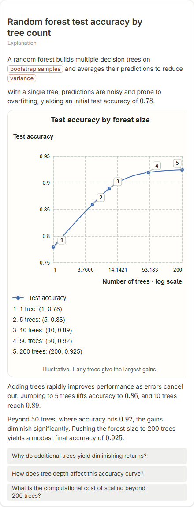
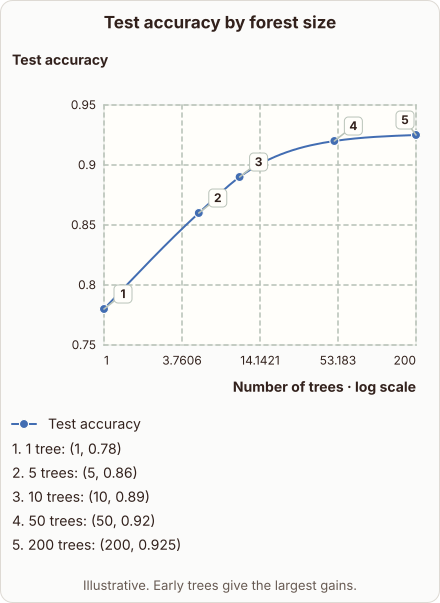
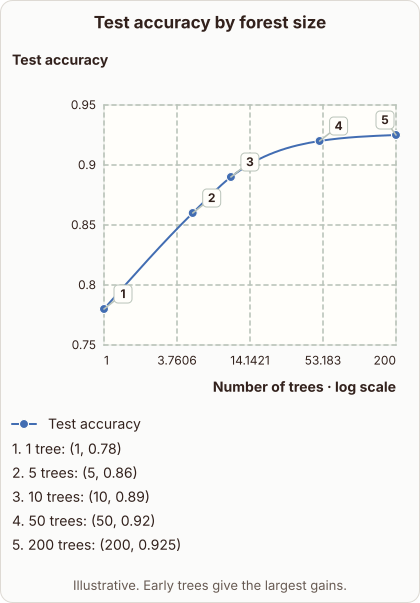

# Random forest test accuracy by tree count

- Prompt: how does test accuracy change with 1, 5, 10, 50 and 200 trees in a random forest?
- Depth: Balanced (bench key standard)
- Expected reference: ml-trees-forest-size-accuracy; expected kind: coordinate-plot
- Sent bare: only the prompt (no lesson, no context, no selection); depth standard
- Selector hit (expected reference among the references sent to the author): yes; first pick (expected reference sent first): no
- References sent to the author (attempt 0, selector order): shape-coordinate-plot, ml-trees-forest-size-accuracy
- Steer (explanation_plan_kind_from_reference): no (event absent)
- Planner kind: coordinate-plot (fixed); planner kind = expected: yes
- Model kind (first diagram): coordinate-plot; all visuals: coordinate-plot; model kind = expected: yes
- Picture routing: planner pictures 0; pictures in the card 0; dropped none
- Repaired: no; visual fallback: no; server corrections: null
- Authored by google / gemini-3.5-flash-lite
- Time 3396 ms (model call(s) 3200 ms); tokens in/out 3863/695; cost US$0.002897
- Factual (factual-v2): 4/5, error no - Statements are accurate or acceptable simplifications. Random forests average (or vote) predictions over bootstrap-trained trees to reduce variance. The numbers are labeled illustrative. A minor imprecision is that classification forests typically use majority voting, and the card also omits feature subsampling.

| model (440 px) | reference (408 px) |
|---|---|
|  |  |

## Body (as saved, visual markers in place)

A random forest builds multiple decision trees on bootstrap samples and averages their predictions to reduce variance.

With a single tree, predictions are noisy and prone to overfitting, yielding an initial test accuracy of $0.78$.

[[visual:1]]

Adding trees rapidly improves performance as errors cancel out. Jumping to 5 trees lifts accuracy to $0.86$, and 10 trees reach $0.89$.

Beyond 50 trees, where accuracy hits $0.92$, the gains diminish significantly. Pushing the forest size to 200 trees yields a modest final accuracy of $0.925$.

## Visuals

- [[visual:1]] diagram, kind **coordinate-plot**, title "Test accuracy by forest size", caption "Illustrative. Early trees give the largest gains." ([spec](visual-1.json), [svg](visual-1.svg), [png](visual-1.png))

## Follow-up questions

1. Why do additional trees yield diminishing returns?
2. How does tree depth affect this accuracy curve?
3. What is the computational cost of scaling beyond 200 trees?
