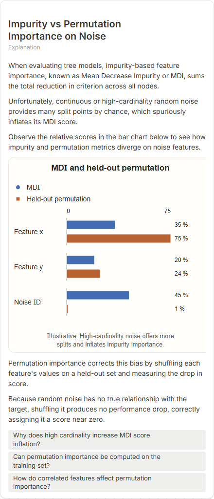
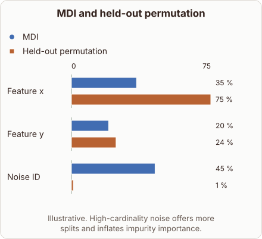
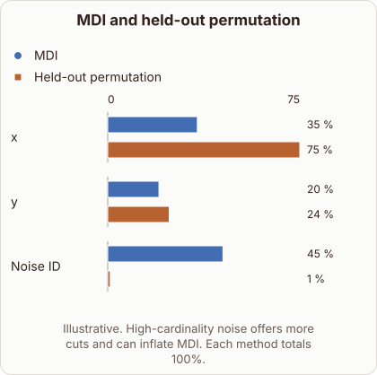

# Impurity vs Permutation Importance on Noise

- Prompt: compare impurity-based feature importance with permutation importance when one feature is random noise
- Depth: Balanced (bench key standard)
- Expected reference: ml-trees-feature-importance; expected kind: bar-chart
- Sent bare: only the prompt (no lesson, no context, no selection); depth standard
- Selector hit (expected reference among the references sent to the author): yes; first pick (expected reference sent first): no
- References sent to the author (attempt 0, selector order): shape-bar-chart, ml-trees-feature-importance, permutation-feature-importance
- Steer (explanation_plan_kind_from_reference): plannerKind comparison, reference ml-trees-feature-importance, referenceKind bar-chart, steerSource reference, score 50
- Planner kind: bar-chart (fixed); planner kind = expected: yes
- Model kind (first diagram): bar-chart; all visuals: bar-chart; model kind = expected: yes
- Picture routing: planner pictures 0; pictures in the card 0; dropped none
- Repaired: no; visual fallback: no; server corrections: null
- Authored by google / gemini-3.5-flash-lite
- Time 3365 ms (model call(s) 3177 ms); tokens in/out 3779/546; cost US$0.002499
- Factual (factual-v2): 4/5, error no - Accurate overall. MDI is biased toward high-cardinality features, and held-out permutation importance gives noise a score near zero. Two simplifications: 'corrects this bias' slightly overstates (permutation importance can still be affected by correlated features), and MDI is summed per feature, weighted by node sample counts.

| model (440 px) | reference (408 px) |
|---|---|
|  |  |

## Body (as saved, visual markers in place)

When evaluating tree models, impurity-based feature importance, known as Mean Decrease Impurity or MDI, sums the total reduction in criterion across all nodes.

Unfortunately, continuous or high-cardinality random noise provides many split points by chance, which spuriously inflates its MDI score.

Observe the relative scores in the bar chart below to see how impurity and permutation metrics diverge on noise features.

[[visual:1]]

Permutation importance corrects this bias by shuffling each feature's values on a held-out set and measuring the drop in score.

Because random noise has no true relationship with the target, shuffling it produces no performance drop, correctly assigning it a score near zero.

## Visuals

- [[visual:1]] diagram, kind **bar-chart**, title "MDI and held-out permutation", caption "Illustrative. High-cardinality noise offers more splits and inflates impurity importance." ([spec](visual-1.json), [svg](visual-1.svg), [png](visual-1.png))

## Follow-up questions

1. Why does high cardinality increase MDI score inflation?
2. Can permutation importance be computed on the training set?
3. How do correlated features affect permutation importance?
