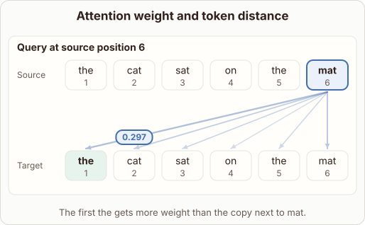
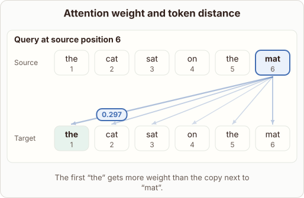

# Self-Attention Distance and Weight

- Prompt (reference.prompts[0]): Can self-attention give a distant word more weight than its neighbor?
- Reference id: ml-transformer-attention-across-distance (source: Transformer)
- Intended kind (reference.spec.diagram.kind): token-links
- Planner kind: none; planner routed to picture: no
- Model kind (first diagram): token-links; all diagrams: token-links
- Selector hit (intended reference among the references sent): yes
- References sent to the author (attempt 0): ml-transformer-attention-across-distance, knn-neighbourhood
- Structure (faithful-ref-v1, reference vs model spec): fully - The diagram matches the reference. It is a token-links diagram with the same source and target tokens, and the "mat" query links to every target with the same weights. It also has the normalization note and the caption.
- Factual (factual-v2): 4/5, error no - Mostly correct. Saying weights depend on content 'rather than physical distance' simplifies things, since positional encodings (e.g. RoPE, ALiBi) also inject distance information. The diagram's example is plausible but illustrative.
- Repaired: no; visual fallback: no; authored by google / gemini-3.5-flash-lite
- Time 5002 ms; author tokens in/out 3899/287; cost US$0.001888

| model (408 px) | reference (408 px) |
|---|---|
|  |  |

## Card body (as saved)

Self-attention calculates token relationships using dot products of queries and keys. This means weights depend on semantic relevance rather than physical distance.

A distant word can easily receive a higher attention score than an immediate neighbor if its vector representation aligns better with the query token.

```rh-diagram
{"version":1,"diagram":{"title":"Attention weight and token distance","caption":"The first the gets more weight than the copy next to mat.","kind":"token-links","source":["the","cat","sat","on","the","mat"],"target":["the","cat","sat","on","the","mat"],"queries":[{"index":5,"weights":[0.297,0.18,0.126,0.075,0.105,0.217]}],"normalized":true}}
```

Contextual meaning dictates the score, letting models bridge long gaps in a sentence.
