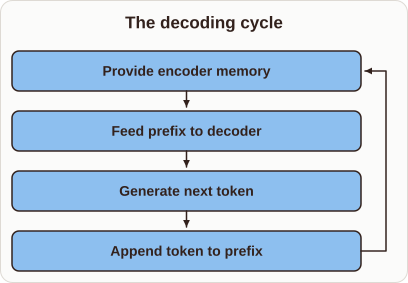
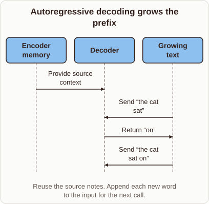

# Transformer Autoregressive Decoding Loop

- Prompt (reference.prompts[0]): How does Transformer decoding append a word and feed it back in?
- Reference id: ml-transformer-autoregressive-prefix (source: Transformer)
- Intended kind (reference.spec.diagram.kind): sequence
- Planner kind: cycle (fixed); planner routed to picture: no
- Model kind (first diagram): cycle; all diagrams: cycle
- Selector hit (intended reference among the references sent): yes
- References sent to the author (attempt 0): shape-cycle, ml-transformer-autoregressive-prefix
- Structure (faithful-ref-v1, reference vs model spec): partly - The diagram is a cycle (flowchart-like), not a sequence diagram with three actors (Encoder memory, Decoder, Growing text). It does capture the ideas of encoder memory, feeding the prefix, generating a token and appending it. But it has no separate actors and no message directions between them. The prefix growing across calls is only implicit in the loop.
- Factual (factual-v2): 4/5, error no - Minor imprecision: encoder memory applies only to encoder-decoder models, not decoder-only ones; 'word' stands in for 'token'.
- Repaired: no; visual fallback: no; authored by google / gemini-3.5-flash-lite
- Time 2951 ms; author tokens in/out 3789/329; cost US$0.00196

| model (408 px) | reference (408 px) |
|---|---|
|  |  |

## Card body (as saved)

Transformer decoding generates text one token at a time by feeding its own previous outputs back into itself.

This autoregressive process relies on a preserved encoder memory that supplies source context at every single step.

```rh-diagram
{"version":1,"diagram":{"title":"The decoding cycle","kind":"cycle","steps":["Provide encoder memory","Feed prefix to decoder","Generate next token","Append token to prefix"]}}
```

The model takes the growing prefix, passes it through masked self-attention, and predicts the probability distribution of the very next word.

That newly computed token is then appended directly to the input sequence before the next forward pass runs.
