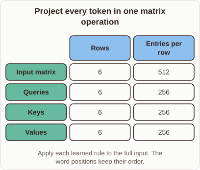

# Projecting All Tokens to Q, K, and V

- Prompt (reference.prompts[0]): How does a Transformer project all tokens into Q, K, and V at once?
- Reference id: ml-transformer-batched-qkv (source: Transformer)
- Intended kind (reference.spec.diagram.kind): matrix
- Planner kind: transformation (not fixed; offered transformation | tensor); planner routed to picture: no
- Model kind (first diagram): matrix; all diagrams: matrix
- Selector hit (intended reference among the references sent): yes
- References sent to the author (attempt 0): shape-transformation, ml-transformer-batched-qkv, knn-k-validation
- Structure (faithful-ref-v1, reference vs model spec): fully - The diagram matches the reference exactly. It is a matrix with the same title, the same four rows (Input, Queries, Keys, Values), the same two columns, the same values and the same caption.
- Factual (factual-v2): 5/5, error no
- Repaired: yes (other: explanation_bad_diagram: the rh-diagram spec is not valid (diagram.rows.0.id: Select layout teaching); visual fallback: no; authored by google / gemini-3.5-flash-lite
- Time 7150 ms; author tokens in/out 8677/1076; cost US$0.005294

| model (408 px) | reference (408 px) |
|---|---|
|  |  |

## Card body (as saved)

Transformers project all sequence tokens simultaneously by packing them into a single input matrix and multiplying it by learned weight matrices.

Each row represents a distinct token, while the columns store its embedding features. Multiplying this input matrix by the query, key, and value weights transforms the entire sequence in parallel.

```rh-diagram
{"version":1,"diagram":{"title":"Project every token in one matrix operation","caption":"Apply each learned rule to the full input. The word positions keep their order.","kind":"matrix","columns":["Rows","Entries per row"],"rows":[{"heading":"Input matrix","cells":["6","512"]},{"heading":"Queries","cells":["6","256"]},{"heading":"Keys","cells":["6","256"]},{"heading":"Values","cells":["6","256"]}]}}
```

This batched multiplication preserves token order while mapping every position into the new feature spaces. By avoiding loops over individual words, the model achieves high computational efficiency during self-attention.
