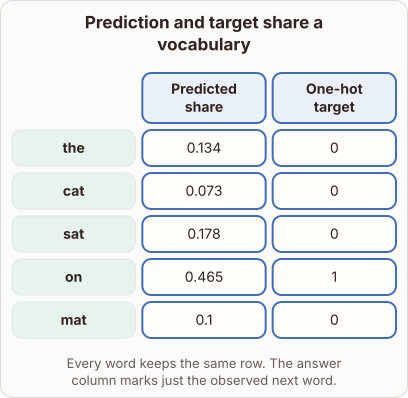
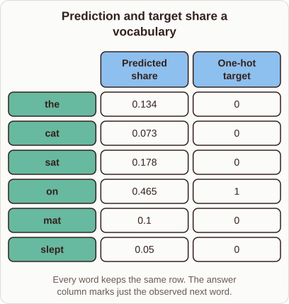

# Next-Token Training Comparison

- Prompt (reference.prompts[0]): How does next-token training compare a probability vector with a one-hot target?
- Reference id: ml-transformer-one-hot-target (source: Transformer)
- Intended kind (reference.spec.diagram.kind): matrix
- Planner kind: comparison (not fixed; offered comparison | bar-chart); planner routed to picture: no
- Model kind (first diagram): matrix; all diagrams: matrix
- Selector hit (intended reference among the references sent): yes
- References sent to the author (attempt 0): shape-comparison, ml-transformer-one-hot-target, one-hot-encoding
- Structure (faithful-ref-v1, reference vs model spec): fully - The diagram is a matrix with the same two columns and the same rows (the, cat, sat, on, mat), with identical values and "on" marked 1. It leaves out the "slept" row (0.05, 0). That is a minor detail, and the row-to-column structure is intact.
- Factual (factual-v2): 3/5, error yes - The predicted shares in the matrix (0.134+0.073+0.178+0.465+0.1) sum to 0.95, not 1, so they are not a valid probability distribution over the vocabulary shown.
- Repaired: yes (other: explanation_bad_diagram: the rh-diagram spec is not valid (diagram.emphasis.columns.1: Reference an ); visual fallback: no; authored by google / gemini-3.5-flash-lite
- Time 7286 ms; author tokens in/out 8529/1190; cost US$0.005535

| model (408 px) | reference (408 px) |
|---|---|
|  |  |

## Card body (as saved)

Next-token training evaluates model outputs by comparing the predicted probability vector against a target vector. Each entry corresponds to a specific vocabulary token, aligning predictions directly with ground truth.

```rh-diagram
{"version":1,"diagram":{"title":"Prediction and target share a vocabulary","caption":"Every word keeps the same row. The answer column marks just the observed next word.","kind":"matrix","layout":"teaching","columns":["Predicted share","One-hot target"],"rows":[{"id":"r1","heading":"the","cells":["0.134","0"]},{"id":"r2","heading":"cat","cells":["0.073","0"]},{"id":"r3","heading":"sat","cells":["0.178","0"]},{"id":"r4","heading":"on","cells":["0.465","1"]},{"id":"r5","heading":"mat","cells":["0.1","0"]}],"emphasis":{"columns":[0,1]}}}
```

The one-hot target assigns a value of $1$ to the actual next token and $0$ to all other vocabulary entries. Loss functions measure the divergence between these distributions to update model weights.

As the predicted probability for the correct token approaches $1$, the computed loss decreases significantly. This direct comparison penalizes incorrect high-confidence predictions.
