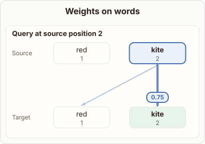
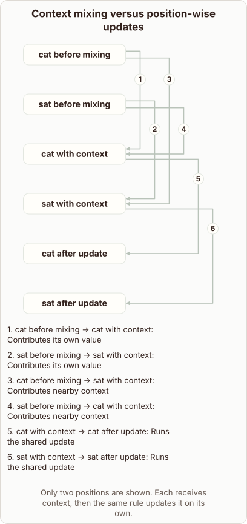

# Attention Mixing and Position-wise Updates

- Prompt (reference.prompts[0]): Why does attention mix words while the feed-forward network is position-wise?
- Reference id: ml-transformer-positionwise-feedforward (source: Transformer)
- Intended kind (reference.spec.diagram.kind): relationship
- Planner kind: token-links (fixed); planner routed to picture: no
- Model kind (first diagram): token-links; all diagrams: token-links
- Selector hit (intended reference among the references sent): yes
- References sent to the author (attempt 0): shape-token-links, ml-transformer-positionwise-feedforward
- Structure (faithful-ref-v1, reference vs model spec): not - The reference is a relationship graph with six nodes. It shows tokens contributing their own value and nearby context, then a shared per-position update. The diagram is an attention-weights view for one query, "kite". It has no context-mixed nodes, no shared update step and no per-position after-update nodes. It shows none of the reference structure.
- Factual (factual-v2): 5/5, error no
- Repaired: no; visual fallback: no; authored by google / gemini-3.5-flash-lite
- Time 2622 ms; author tokens in/out 3896/274; cost US$0.001854

| model (408 px) | reference (408 px) |
|---|---|
|  |  |

## Card body (as saved)

Attention computes dot products between queries and keys across all positions, allowing tokens to gather context from other words in the sequence.

```rh-diagram
{"version":1,"diagram":{"title":"Weights on words","kind":"token-links","source":["red","kite"],"target":["red","kite"],"queries":[{"index":1,"weights":[0.25,0.75]}],"normalized":true}}
```

After gathering this contextual information, the feed-forward network processes each position independently using identical parameters without mixing information across tokens.
