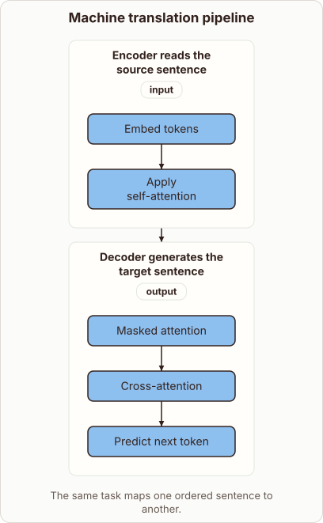
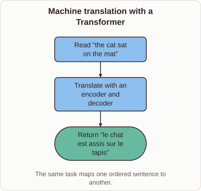

# Machine translation with a Transformer

- Prompt (reference.prompts[0]): How does a transformer translate a sentence from one language into another?
- Reference id: ml-transformer-translation-task (source: Transformer)
- Intended kind (reference.spec.diagram.kind): flow
- Planner kind: block-stack (fixed); planner routed to picture: no
- Model kind (first diagram): block-stack; all diagrams: block-stack
- Selector hit (intended reference among the references sent): yes
- References sent to the author (attempt 0): shape-block-stack, ml-transformer-translation-task
- Structure (faithful-ref-v1, reference vs model spec): fully - The diagram is a flow from reading the source sentence (encoder) to generating the target sentence (decoder). That matches the reference's input → translate → output chain. It adds detail inside each stage and omits the example sentences, which are optional.
- Factual (factual-v2): 5/5, error no
- Repaired: no; visual fallback: no; authored by google / gemini-3.5-flash-lite
- Time 3210 ms; author tokens in/out 3792/588; cost US$0.002608

| model (408 px) | reference (408 px) |
|---|---|
|  |  |

## Card body (as saved)

Transformers translate sentences by mapping input sequences to continuous representations and decoding them into a new language.

```rh-diagram
{"version":1,"diagram":{"title":"Machine translation pipeline","caption":"The same task maps one ordered sentence to another.","kind":"block-stack","blocks":[{"id":"source","label":"Encoder reads the source sentence","dims":"input","diagram":{"kind":"flow","steps":["Embed tokens","Apply self-attention"]}},{"id":"target","label":"Decoder generates the target sentence","dims":"output","diagram":{"kind":"flow","steps":["Masked attention","Cross-attention","Predict next token"]}}]}}
```

The encoder reads the entire source sentence at once, using self-attention to weigh relationships between all words simultaneously.

This creates contextualized vector embeddings that capture the meaning of each word based on its surrounding context.

The decoder then generates the target sentence step by step, attending to both its own previous outputs and the encoder's representations.

Masked attention prevents the decoder from looking ahead at future tokens, ensuring realistic left-to-right text generation.
