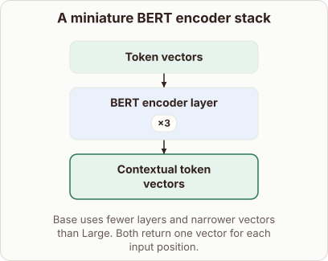

# BERT Base vs BERT Large

- Prompt (reference.prompts[0]): What changes between BERT Base and BERT Large?
- Reference id: ml-bert-encoder-depth (source: BERT)
- Intended kind (reference.spec.diagram.kind): block-stack
- Planner kind: comparison (fixed); planner routed to picture: no
- Model kind (first diagram): comparison; all diagrams: comparison
- Selector hit (intended reference among the references sent): yes
- References sent to the author (attempt 0): shape-comparison, ml-bert-encoder-depth
- Structure (faithful-ref-v1, reference vs model spec): not - The reference is a block-stack: token vectors, then a repeated encoder layer, then contextual token vectors. The diagram is a Base vs Large comparison of specs. It has no input, repeated layer or output flow, so it shows none of the reference structure.
- Factual (factual-v2): 5/5, error no
- Repaired: no; visual fallback: no; authored by google / gemini-3.5-flash-lite
- Time 3133 ms; author tokens in/out 3775/375; cost US$0.00207

| model (408 px) | reference (408 px) |
|---|---|
|  |  |

## Card body (as saved)

BERT comes in two main sizes, Base and Large, which share the same underlying architecture but differ in scale.

Scaling up increases both the representation capacity and the computational cost required for training and inference.

```rh-diagram
{"version":1,"diagram":{"title":"BERT Base and BERT Large compared","caption":"Large scales up depth, width, and attention heads.","kind":"comparison","columns":[{"heading":"BERT Base","items":["$12$ encoder layers","$768$ hidden size","$12$ attention heads","$110$M parameters"]},{"heading":"BERT Large","items":["$24$ encoder layers","$1024$ hidden size","$16$ attention heads","$340$M parameters"]}]}}
```

Both models process token vectors through stacked transformer encoder layers using self-attention mechanisms.

BERT Large doubles the number of layers and expands the hidden dimension, allowing it to capture more complex linguistic patterns.
