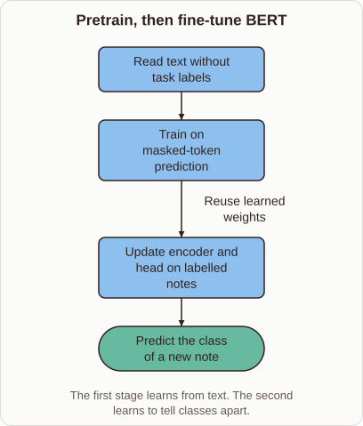
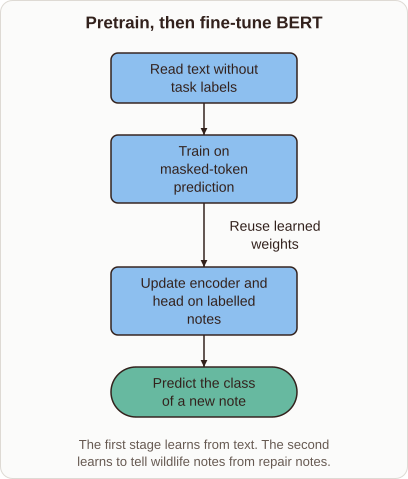

# Fine-Tuning BERT for Text Classification

- Prompt (reference.prompts[0]): What happens when you fine-tune BERT for text classification?
- Reference id: ml-bert-fine-tuning (source: BERT)
- Intended kind (reference.spec.diagram.kind): flow
- Planner kind: flow (not fixed; offered flow | layers); planner routed to picture: no
- Model kind (first diagram): flow; all diagrams: flow
- Selector hit (intended reference among the references sent): yes
- References sent to the author (attempt 0): shape-flow, ml-bert-fine-tuning, nearest-centroid-boundary
- Structure (faithful-ref-v1, reference vs model spec): fully - The diagram has the same four nodes in the same order. It has the same three edges, including the "Reuse learned weights" label. Only the caption wording differs slightly, which is an optional difference.
- Factual (factual-v2): 5/5, error no
- Repaired: no; visual fallback: no; authored by google / gemini-3.5-flash-lite
- Time 4138 ms; author tokens in/out 4147/358; cost US$0.00214

| model (408 px) | reference (408 px) |
|---|---|
|  |  |

## Card body (as saved)

Fine-tuning takes a pretrained language model and adapts it for a specific downstream task like text classification.

By reusing weights learned from massive text corpora, the model already understands grammar and word relationships.

```rh-diagram
{"version":1,"diagram":{"title":"Pretrain, then fine-tune BERT","caption":"The first stage learns from text. The second learns to tell classes apart.","kind":"flow","nodes":[{"id":"text","label":"Read text without task labels","role":"process"},{"id":"pretrain","label":"Train on masked-token prediction","role":"process"},{"id":"train","label":"Update encoder and head on labelled notes","role":"process"},{"id":"output","label":"Predict the class of a new note","role":"outcome"}],"edges":[{"from":"text","to":"pretrain"},{"from":"pretrain","to":"train","label":"Reuse learned weights"},{"from":"train","to":"output"}]}}
```

During fine-tuning, a small task-specific classification head is attached to the architecture.

The entire network updates its parameters slightly when exposed to labelled data, aligning general language representations with the target categories.
