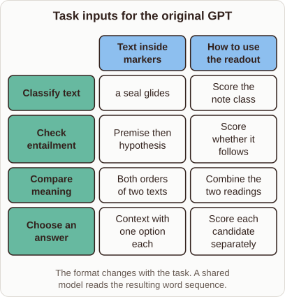

# Task Adaptation in the Original GPT

- Prompt (reference.prompts[0]): How did the original GPT adapt one model to sentence pairs and multiple-choice questions?
- Reference id: ml-bert-gpt-task-inputs (source: BERT)
- Intended kind (reference.spec.diagram.kind): matrix
- Planner kind: transformation (not fixed; offered transformation | flow); planner routed to picture: no
- Model kind (first diagram): matrix; all diagrams: matrix
- Selector hit (intended reference among the references sent): yes
- References sent to the author (attempt 0): shape-transformation, ml-bert-gpt-task-inputs
- Structure (faithful-ref-v1, reference vs model spec): fully - The diagram matches the reference matrix exactly: same title, columns, four task rows, cell contents and caption.
- Factual (factual-v2): 4/5, error no - Minor imprecision: the prose says options were merged into a single sequence, but each (context, option) pair is processed as its own sequence, as the later sentence says.
- Repaired: yes (other: explanation_bad_diagram: the rh-diagram spec is not valid (diagram.rows.0.id: Select layout teaching); visual fallback: no; authored by google / gemini-3.5-flash-lite
- Time 7403 ms; author tokens in/out 8228/866; cost US$0.004635

| model (408 px) | reference (408 px) |
|---|---|
|  |  |

## Card body (as saved)

The original GPT model avoided task-specific architectures by framing various NLP tasks as standard sequence processing.

Input text streams received special delimiter tokens so that distinct sentences or options merged into a single linear sequence that the pretrained decoder could read directly.

```rh-diagram
{"version":1,"diagram":{"title":"Task inputs for the original GPT","caption":"The format changes with the task. A shared model reads the resulting word sequence.","kind":"matrix","columns":["Text inside markers","How to use the readout"],"rows":[{"heading":"Classify text","cells":["a seal glides","Score the note class"]},{"heading":"Check entailment","cells":["Premise then hypothesis","Score whether it follows"]},{"heading":"Compare meaning","cells":["Both orders of two texts","Combine the two readings"]},{"heading":"Choose an answer","cells":["Context with one option each","Score each candidate separately"]}]}}
```

For sentence pairs like entailment or similarity, the model processed concatenated text with boundary tokens inserted.

Multiple-choice questions were evaluated by running each candidate answer alongside the context independently and scoring the resulting final token.
