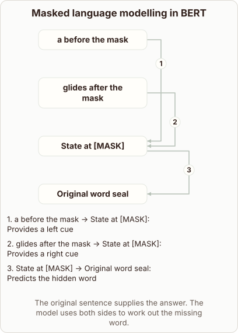
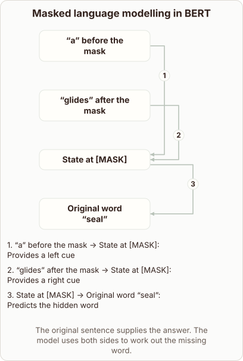

# BERT Masked Language Modelling Mechanism

- Prompt (reference.prompts[0]): How does BERT learn by filling in a masked word?
- Reference id: ml-bert-masked-token (source: BERT)
- Intended kind (reference.spec.diagram.kind): relationship
- Planner kind: flow (not fixed; offered flow | token-links); planner routed to picture: no
- Model kind (first diagram): relationship; all diagrams: relationship
- Selector hit (intended reference among the references sent): yes
- References sent to the author (attempt 0): shape-flow, ml-bert-masked-token
- Structure (faithful-ref-v1, reference vs model spec): fully - The diagram has all four nodes and all three labelled edges, with the same structure as the reference. The only differences are the missing quotation marks around "a", "glides" and "seal", and that is only wording.
- Factual (factual-v2): 5/5, error no
- Repaired: no; visual fallback: no; authored by google / gemini-3.5-flash-lite
- Time 3194 ms; author tokens in/out 3906/549; cost US$0.002545

| model (408 px) | reference (408 px) |
|---|---|
|  |  |

## Card body (as saved)

BERT learns language by hiding words in a sentence and training its network to guess them. This task is called masked language modelling.

```rh-diagram
{"version":1,"diagram":{"title":"Masked language modelling in BERT","caption":"The original sentence supplies the answer. The model uses both sides to work out the missing word.","kind":"relationship","layout":"graph","nodes":[{"id":"left","label":"a before the mask"},{"id":"right","label":"glides after the mask"},{"id":"mask","label":"State at [MASK]"},{"id":"answer","label":"Original word seal"}],"edges":[{"from":"left","to":"mask","label":"Provides a left cue"},{"from":"right","to":"mask","label":"Provides a right cue"},{"from":"mask","to":"answer","label":"Predicts the hidden word"}]}}
```

During training, the model replaces certain tokens with a special symbol. It reads the surrounding text in both directions simultaneously to understand the context.

It processes the contextual cues to output a probability distribution over the vocabulary. The network adjusts its weights by comparing this prediction against the original hidden word.
