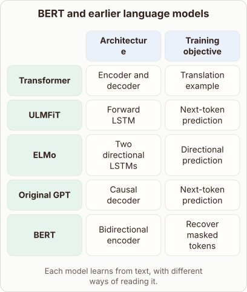
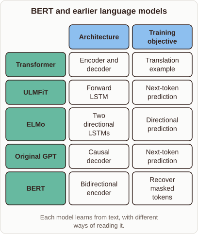

# Evolution of Pretrained Language Models

- Prompt (reference.prompts[0]): How did BERT build on the ideas behind the original Transformer, ELMo, and GPT?
- Reference id: ml-bert-pretraining-families (source: BERT)
- Intended kind (reference.spec.diagram.kind): matrix
- Planner kind: comparison (fixed); planner routed to picture: no
- Model kind (first diagram): matrix; all diagrams: matrix
- Selector hit (intended reference among the references sent): yes
- References sent to the author (attempt 0): shape-comparison, ml-bert-pretraining-families
- Structure (faithful-ref-v1, reference vs model spec): fully - The diagram is a matrix with the same title, columns, five rows, cell values and caption as the reference.
- Factual (factual-v2): 3/5, error yes - Says BERT combined the 'deep bidirectional context of ELMo'; ELMo's bidirectionality is shallow (separate forward/backward LSTMs concatenated), and BERT's novelty was truly deep bidirectionality.
- Repaired: yes (other: explanation_bad_diagram: the rh-diagram spec is not valid (diagram.rows.0.id: Select layout teaching); visual fallback: no; authored by google / gemini-3.5-flash-lite
- Time 7839 ms; author tokens in/out 8104/1284; cost US$0.005642

| model (408 px) | reference (408 px) |
|---|---|
|  |  |

## Card body (as saved)

Language models evolved by combining deep contextual representations with scalable architectures.

Early approaches like ELMo used recurrent networks to extract features, while the original Transformer introduced self-attention.

GPT adopted the decoder stack for causal generation, predicting future tokens sequentially.

```rh-diagram
{"version":1,"diagram":{"title":"BERT and earlier language models","caption":"Each model learns from text, with different ways of reading it.","kind":"matrix","layout":"teaching","columns":["Architecture","Training objective"],"rows":[{"id":"r1","heading":"Transformer","cells":["Encoder and decoder","Translation example"]},{"id":"r2","heading":"ULMFiT","cells":["Forward LSTM","Next-token prediction"]},{"id":"r3","heading":"ELMo","cells":["Two directional LSTMs","Directional prediction"]},{"id":"r4","heading":"Original GPT","cells":["Causal decoder","Next-token prediction"]},{"id":"r5","heading":"BERT","cells":["Bidirectional encoder","Recover masked tokens"]}]}}
```

BERT combined the deep bidirectional context of ELMo with the Transformer architecture. Instead of predicting the next word, it masked tokens randomly and learned to recover them.

This bidirectional encoder design allowed every layer to attend to both left and right context simultaneously.
