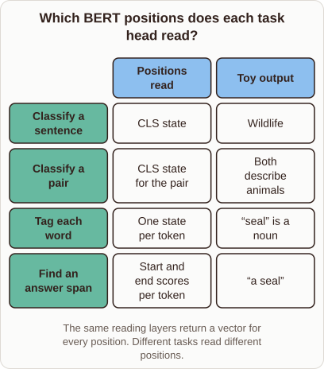

# BERT Task Heads

- Prompt (reference.prompts[0]): How does BERT use different outputs for classification, tagging, and question answering?
- Reference id: ml-bert-task-heads (source: BERT)
- Intended kind (reference.spec.diagram.kind): matrix
- Planner kind: comparison (not fixed; offered comparison | block-stack); planner routed to picture: no
- Model kind (first diagram): matrix; all diagrams: matrix
- Selector hit (intended reference among the references sent): yes
- References sent to the author (attempt 0): shape-comparison, ml-bert-task-heads, nearest-centroid-boundary
- Structure (faithful-ref-v1, reference vs model spec): fully - The diagram matches the reference matrix: same title, four rows, two columns and cell contents. The only difference is that the quotation marks are missing, which is minor.
- Factual (factual-v2): 3/5, error yes - Saying the encoder is kept fixed is misleading: standard BERT fine-tuning updates all encoder weights along with the task head, rather than freezing the encoder.
- Repaired: yes (other: explanation_bad_diagram: the rh-diagram spec is not valid (diagram.rows.0.id: Select layout teaching); visual fallback: no; authored by google / gemini-3.5-flash-lite
- Time 6768 ms; author tokens in/out 8576/1092; cost US$0.005304

| model (408 px) | reference (408 px) |
|---|---|
|  |  |

## Card body (as saved)

BERT processes input tokens through stacked transformer layers to produce contextual vectors. The model keeps its encoder fixed and routes these vectors to specialized task heads depending on the objective.

```rh-diagram
{"version":1,"diagram":{"title":"Which BERT positions does each task head read?","caption":"The same reading layers return a vector for every position. Different tasks read different positions.","kind":"matrix","columns":["Positions read","Toy output"],"rows":[{"heading":"Classify a sentence","cells":["CLS state","Wildlife"]},{"heading":"Classify a pair","cells":["CLS state for the pair","Both describe animals"]},{"heading":"Tag each word","cells":["One state per token","seal is a noun"]},{"heading":"Find an answer span","cells":["Start and end scores per token","a seal"]}]}}
```

For sentence classification, the head reads only the special classification token position. Sequence labeling tasks read the vector at every token position independently.

Question answering predicts start and end positions by scoring every token.
