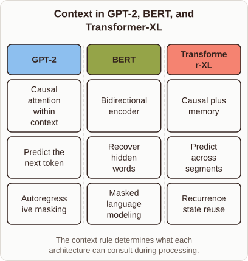
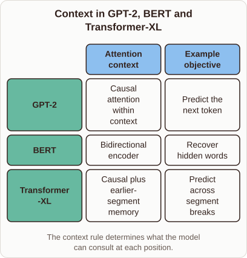

# Differences Between GPT-2, BERT, and Transformer-XL

- Prompt (reference.prompts[0]): What is the difference between GPT-2, BERT, and Transformer-XL?
- Reference id: ml-gpt2-context-architecture (source: GPT-2)
- Intended kind (reference.spec.diagram.kind): matrix
- Planner kind: comparison (fixed); planner routed to picture: no
- Model kind (first diagram): comparison; all diagrams: comparison
- Selector hit (intended reference among the references sent): yes
- References sent to the author (attempt 0): shape-comparison, ml-gpt2-context-architecture
- Structure (faithful-ref-v1, reference vs model spec): fully - The diagram is a matrix with the same three rows (GPT-2, BERT, Transformer-XL). Each row has the attention-context and objective content that the reference has. It adds a third column, which is optional detail. The column headers aren't visible in the description, but the cell structure matches.
- Factual (factual-v2): 5/5, error no
- Repaired: no; visual fallback: no; authored by google / gemini-3.5-flash-lite
- Time 3492 ms; author tokens in/out 3798/378; cost US$0.002085

| model (408 px) | reference (408 px) |
|---|---|
|  |  |

## Card body (as saved)

GPT-2 uses a causal attention mask so each token attends only to previous tokens. This design enables autoregressive text generation by predicting the next token in sequence.

BERT employs a bidirectional encoder to read context from both left and right simultaneously. It is trained via masked language modeling to recover hidden words rather than generate text sequentially.

Transformer-XL introduces segment-level recurrence with state reuse to extend context beyond fixed window limits.

```rh-diagram
{"version":1,"diagram":{"title":"Context in GPT-2, BERT, and Transformer-XL","caption":"The context rule determines what each architecture can consult during processing.","kind":"comparison","columns":[{"heading":"GPT-2","items":["Causal attention within context","Predict the next token","Autoregressive masking"]},{"heading":"BERT","items":["Bidirectional encoder","Recover hidden words","Masked language modeling"]},{"heading":"Transformer-XL","items":["Causal plus memory","Predict across segments","Recurrence state reuse"]}]}}
```

This mechanism preserves hidden states from previous segments to prevent context fragmentation across breaks.
