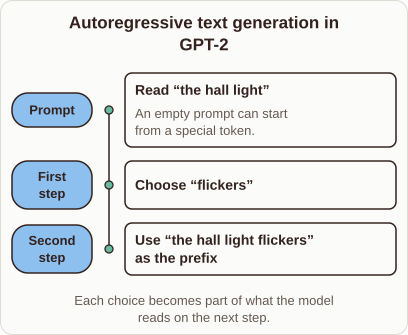

# Autoregressive Text Generation in GPT-2

- Prompt (reference.prompts[0]): How does GPT-2 generate text one token at a time?
- Reference id: ml-gpt2-continue-prefix (source: GPT-2)
- Intended kind (reference.spec.diagram.kind): timeline
- Planner kind: cycle (not fixed; offered cycle | flow); planner routed to picture: no
- Model kind (first diagram): timeline; all diagrams: timeline
- Selector hit (intended reference among the references sent): yes
- References sent to the author (attempt 0): shape-cycle, ml-gpt2-continue-prefix
- Structure (faithful-ref-v1, reference vs model spec): fully - The diagram's description matches the reference exactly. It is a timeline with the same three ordered events (Prompt, First step, Second step), the same detail note, and the same caption.
- Factual (factual-v2): 5/5, error no
- Repaired: no; visual fallback: no; authored by google / gemini-3.5-flash-lite
- Time 3193 ms; author tokens in/out 3765/351; cost US$0.002007

| model (408 px) | reference (408 px) |
|---|---|
|  |  |

## Card body (as saved)

GPT-2 generates text autoregressively, predicting the next token based on all preceding tokens in the context window. It feeds its own output back into the input sequence for subsequent steps.

```rh-diagram
{"version":1,"diagram":{"title":"Autoregressive text generation in GPT-2","caption":"Each choice becomes part of what the model reads on the next step.","kind":"timeline","events":[{"time":"Prompt","label":"Read “the hall light”","detail":"An empty prompt can start from a special token."},{"time":"First step","label":"Choose “flickers”"},{"time":"Second step","label":"Use “the hall light flickers” as the prefix"}]}}
```

This loop repeats until the model produces an end-of-text token or reaches the maximum length limit.
