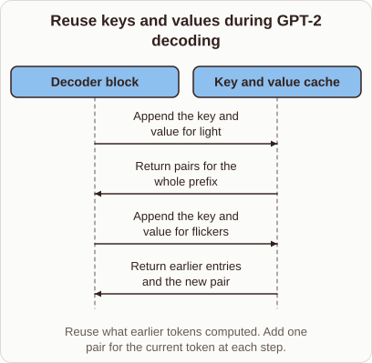
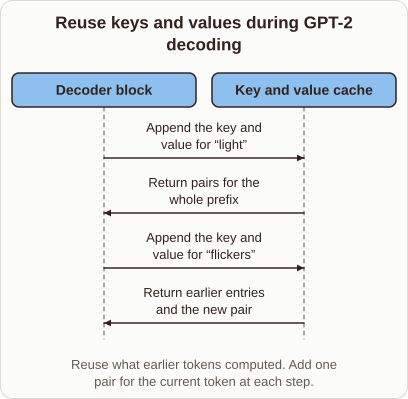

# KV Cache in GPT-2 Generation

- Prompt (reference.prompts[0]): How does the KV cache help GPT-2 reuse work while generating?
- Reference id: ml-gpt2-decode-cache (source: GPT-2)
- Intended kind (reference.spec.diagram.kind): sequence
- Planner kind: token-links (not fixed; offered token-links | block-stack); planner routed to picture: no
- Model kind (first diagram): sequence; all diagrams: sequence
- Selector hit (intended reference among the references sent): yes
- References sent to the author (attempt 0): shape-token-links, ml-gpt2-decode-cache
- Structure (faithful-ref-v1, reference vs model spec): fully - The diagram has the same sequence structure as the reference. It uses the same two actors and the same four messages in the same order and directions, and the title and caption match. The only difference is that the quotation marks around "light" and "flickers" are missing.
- Factual (factual-v2): 4/5, error no
- Repaired: no; visual fallback: no; authored by google / gemini-3.5-flash-lite
- Time 3914 ms; author tokens in/out 3841/462; cost US$0.002308

| model (408 px) | reference (408 px) |
|---|---|
|  |  |

## Card body (as saved)

When generating text autoregressively, the model computes keys and values for every token in the context at each step.

```rh-diagram
{"version":1,"diagram":{"title":"Reuse keys and values during GPT-2 decoding","caption":"Reuse what earlier tokens computed. Add one pair for the current token at each step.","kind":"sequence","actors":[{"id":"block","label":"Decoder block"},{"id":"cache","label":"Key and value cache"}],"messages":[{"from":"block","to":"cache","label":"Append the key and value for light"},{"from":"cache","to":"block","label":"Return pairs for the whole prefix"},{"from":"block","to":"cache","label":"Append the key and value for flickers"},{"from":"cache","to":"block","label":"Return earlier entries and the new pair"}]}}
```

Storing these matrices in a cache avoids redundant calculations for past tokens. The current token only needs to append its own newly computed vectors.

This optimization reduces the time complexity per step from quadratic to linear relative to sequence length.
