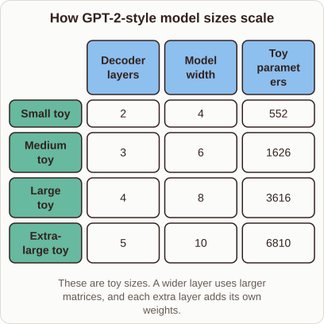

# Why GPT-2 sizes differ in parameter counts

- Prompt (reference.prompts[0]): Why do the different GPT-2 sizes have such different parameter counts?
- Reference id: ml-gpt2-parameter-counts (source: GPT-2)
- Intended kind (reference.spec.diagram.kind): matrix
- Planner kind: comparison (not fixed; offered comparison | block-stack); planner routed to picture: no
- Model kind (first diagram): matrix; all diagrams: matrix
- Selector hit (intended reference among the references sent): yes
- References sent to the author (attempt 0): shape-comparison, ml-gpt2-parameter-counts
- Structure (faithful-ref-v1, reference vs model spec): fully - The diagram's text is identical to the reference: the same matrix with 4 rows, 3 columns, the same cell values and the same caption.
- Factual (factual-v2): 5/5, error no
- Repaired: yes (other: explanation_bad_diagram: the rh-diagram spec is not valid (diagram.rows.0.id: Select layout teaching); visual fallback: no; authored by google / gemini-3.5-flash-lite
- Time 6513 ms; author tokens in/out 8142/905; cost US$0.004706

| model (408 px) | reference (408 px) |
|---|---|
|  |  |

## Card body (as saved)

GPT-2 models change size by scaling two main dimensions: the number of decoder layers and the width of the hidden states.

Each layer contains attention and feed-forward matrices whose sizes depend squarely on the hidden dimension $d_{	ext{model}}$.

```rh-diagram
{"version":1,"diagram":{"title":"How GPT-2-style model sizes scale","caption":"These are toy sizes. A wider layer uses larger matrices, and each extra layer adds its own weights.","kind":"matrix","columns":["Decoder layers","Model width","Toy parameters"],"rows":[{"heading":"Small toy","cells":["2","4","552"]},{"heading":"Medium toy","cells":["3","6","1626"]},{"heading":"Large toy","cells":["4","8","3616"]},{"heading":"Extra-large toy","cells":["5","10","6810"]}]}}
```

When you make a model wider, the weight matrices grow quadratically because the input size and output size both increase.

Adding more layers scales the parameter count linearly, stacking full sets of weights on top of each other.
