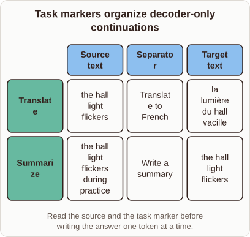

# Task Markers in Decoder-Only Models

- Prompt (reference.prompts[0]): How can GPT-2 use a task marker to translate or summarize text?
- Reference id: ml-gpt2-task-separators (source: GPT-2)
- Intended kind (reference.spec.diagram.kind): matrix
- Planner kind: transformation (not fixed; offered transformation | flow); planner routed to picture: no
- Model kind (first diagram): matrix; all diagrams: matrix
- Selector hit (intended reference among the references sent): yes
- References sent to the author (attempt 0): shape-transformation, ml-gpt2-task-separators
- Structure (faithful-ref-v1, reference vs model spec): fully - The diagram matches the reference: a matrix with the same title, the Translate and Summarize rows, and the Source text, Separator and Target text columns. The cell contents and the caption are the same.
- Factual (factual-v2): 5/5, error no
- Repaired: yes (other: explanation_bad_diagram: the rh-diagram spec is not valid (diagram.rows.0.id: Select layout teaching); visual fallback: no; authored by google / gemini-3.5-flash-lite
- Time 6503 ms; author tokens in/out 8177/825; cost US$0.004517

| model (408 px) | reference (408 px) |
|---|---|
|  |  |

## Card body (as saved)

Decoder-only models like GPT-2 process text autoregressively, predicting the next token based on all prior context.

By appending a specific task marker after an input sequence, we prime the network to generate the expected output format.

```rh-diagram
{"version":1,"diagram":{"title":"Task markers organize decoder-only continuations","caption":"Read the source and the task marker before writing the answer one token at a time.","kind":"matrix","columns":["Source text","Separator","Target text"],"rows":[{"heading":"Translate","cells":["the hall light flickers","Translate to French","la lumière du hall vacille"]},{"heading":"Summarize","cells":["the hall light flickers during practice","Write a summary","the hall light flickers"]}]}}
```

When the prompt includes a phrase like Translate to French, the model attends to both the source sentence and the instruction.

This contextual conditioning shifts its probability distribution toward target tokens in the correct language or format without altering its weights.
