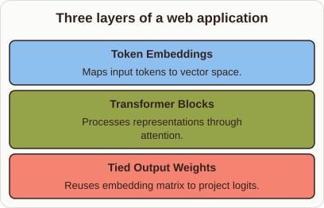
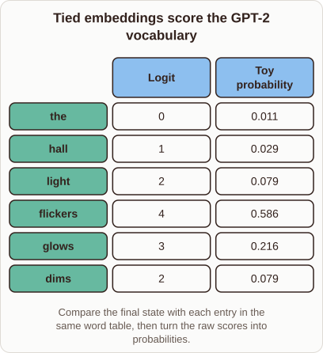

# Why GPT-2 Ties Token Embeddings and Output Weights

- Prompt (reference.prompts[0]): Why does GPT-2 reuse the token embedding weights for its output layer?
- Reference id: ml-gpt2-tied-output-weights (source: GPT-2)
- Intended kind (reference.spec.diagram.kind): matrix
- Planner kind: layers (not fixed; offered layers | block-stack); planner routed to picture: no
- Model kind (first diagram): layers; all diagrams: layers
- Selector hit (intended reference among the references sent): yes
- References sent to the author (attempt 0): shape-layers, ml-gpt2-tied-output-weights, general-layers-2
- Structure (faithful-ref-v1, reference vs model spec): not - The reference is a matrix of vocabulary words with logits and probabilities. The diagram is a three-layer list titled "web application". It has none of the words, scores or probabilities, and it uses a different structure.
- Factual (factual-v2): 3/5, error yes - The diagram is captioned "Three layers of a web application", but it shows the layers of a transformer language model. The prose also overclaims that tying "prevents overfitting and accelerates convergence" and "stabilizes training"; these benefits are not established for GPT-2. The core claim that GPT-2 ties its input embeddings to the output projection is correct.
- Repaired: no; visual fallback: no; authored by google / gemini-3.5-flash-lite
- Time 4095 ms; author tokens in/out 3947/393; cost US$0.002167

| model (408 px) | reference (408 px) |
|---|---|
|  |  |

## Card body (as saved)

GPT-2 reuses its input embedding matrix as the final linear classifier to predict the next token.

This weight tying reduces parameter count significantly and stabilizes training by aligning input representations with output scores.

```rh-diagram
{"version":1,"diagram":{"title":"Three layers of a web application","kind":"layers","layers":[{"label":"Token Embeddings","detail":"Maps input tokens to vector space."},{"label":"Transformer Blocks","detail":"Processes representations through attention."},{"label":"Tied Output Weights","detail":"Reuses embedding matrix to project logits."}]}}
```

By sharing these weights, the model ensures that tokens appearing close in the embedding space receive consistent probability boosts during generation.

This efficient design prevents overfitting and accelerates convergence across large training corpora.
