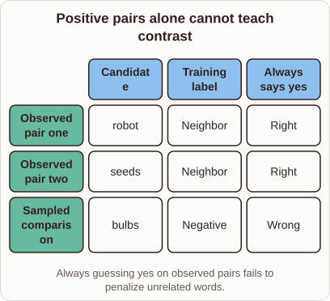
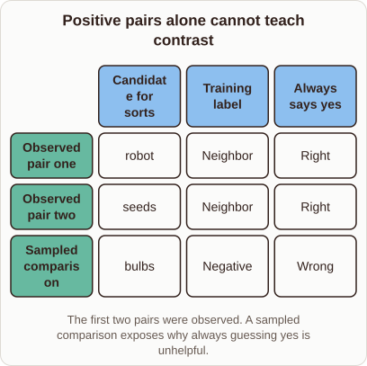

# Why Word2vec needs negative examples

- Prompt (reference.prompts[0]): Why does Word2vec need negative examples when all observed pairs are neighbors?
- Reference id: ml-word2vec-positive-only-failure (source: Word2vec)
- Intended kind (reference.spec.diagram.kind): matrix
- Planner kind: coordinate-plot (not fixed; offered coordinate-plot | token-links); planner routed to picture: no
- Model kind (first diagram): matrix; all diagrams: matrix
- Selector hit (intended reference among the references sent): yes
- References sent to the author (attempt 0): shape-coordinate-plot, ml-word2vec-positive-only-failure, knn-neighbourhood
- Structure (faithful-ref-v1, reference vs model spec): fully - The diagram has the same matrix structure as the reference. It has the same three rows and three columns, with matching cell values: robot, seeds and bulbs; Neighbor, Neighbor and Negative; Right, Right and Wrong. Only the "Candidate" column header and the caption wording differ, and those are optional.
- Factual (factual-v2): 4/5, error no
- Repaired: yes (other: explanation_bad_diagram: the rh-diagram spec is not valid (diagram.rows.0.id: Select layout teaching); visual fallback: no; authored by google / gemini-3.5-flash-lite
- Time 6973 ms; author tokens in/out 8674/981; cost US$0.005055

| model (408 px) | reference (408 px) |
|---|---|
|  |  |

## Card body (as saved)

Word2vec learns vector representations by predicting which words appear near each other in text.

If we only feed positive pairs into the model, it can trivially satisfy the objective by assigning a high similarity score to every possible word pair.

```rh-diagram
{"version":1,"diagram":{"title":"Positive pairs alone cannot teach contrast","caption":"Always guessing yes on observed pairs fails to penalize unrelated words.","kind":"matrix","columns":["Candidate","Training label","Always says yes"],"rows":[{"heading":"Observed pair one","cells":["robot","Neighbor","Right"]},{"heading":"Observed pair two","cells":["seeds","Neighbor","Right"]},{"heading":"Sampled comparison","cells":["bulbs","Negative","Wrong"]}]}}
```

Negative examples force the model to push unrelated words apart in the vector space. Without these contrasting signals, the embeddings would collapse and fail to capture meaningful semantic differences.
