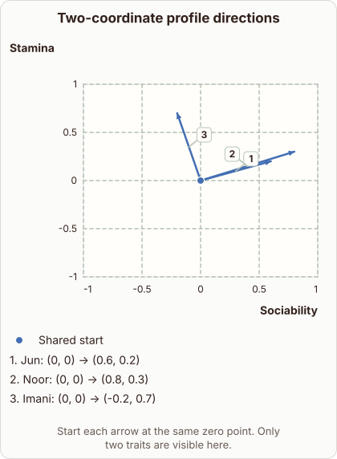

# Direction of a Profile Vector on Two Axes

- Prompt (reference.prompts[0]): How can I see the direction of a profile vector on two axes?
- Reference id: ml-word2vec-profile-directions (source: Word2vec)
- Intended kind (reference.spec.diagram.kind): coordinate-plot
- Planner kind: coordinate-plot (fixed); planner routed to picture: no
- Model kind (first diagram): coordinate-plot; all diagrams: coordinate-plot
- Selector hit (intended reference among the references sent): yes
- References sent to the author (attempt 0): shape-coordinate-plot, ml-word2vec-profile-directions, cosine-vector-directions
- Structure (faithful-ref-v1, reference vs model spec): fully - The diagram matches the reference exactly. It is a coordinate plot with the same axes and ranges, a shared origin point, and the same three vectors (Jun, Noor, Imani) with identical endpoints.
- Factual (factual-v2): 4/5, error no - Minor imprecision: the arrow represents the whole two-trait profile vector, not each trait coordinate separately.
- Repaired: no; visual fallback: no; authored by google / gemini-3.5-flash-lite
- Time 3815 ms; author tokens in/out 4170/698; cost US$0.002996

| model (408 px) | reference (408 px) |
|---|---|
|  |  |

## Card body (as saved)

To see the direction of a profile vector on two axes, you plot each trait coordinate as an arrow originating from the center.

The angle between any two vectors shows how closely their trait profiles align, regardless of their total magnitude. When two vectors point in nearly the same direction, their relative trait balance is similar.

```rh-diagram
{"version":1,"diagram":{"title":"Two-coordinate profile directions","caption":"Start each arrow at the same zero point. Only two traits are visible here.","kind":"coordinate-plot","x":{"label":"Sociability","min":-1,"max":1},"y":{"label":"Stamina","min":-1,"max":1},"series":[{"label":"Shared start","kind":"scatter","points":[{"x":0,"y":0}]}],"annotations":[{"kind":"vector","label":"Jun","from":{"x":0,"y":0},"to":{"x":0.6,"y":0.2}},{"kind":"vector","label":"Noor","from":{"x":0,"y":0},"to":{"x":0.8,"y":0.3}},{"kind":"vector","label":"Imani","from":{"x":0,"y":0},"to":{"x":-0.2,"y":0.7}}]}}
```

Plotting profile vectors this way transforms numerical traits into geometric headings. By anchoring all arrows at the origin $ (0,0) $, you compare directions directly using the orientation of each line segment.
