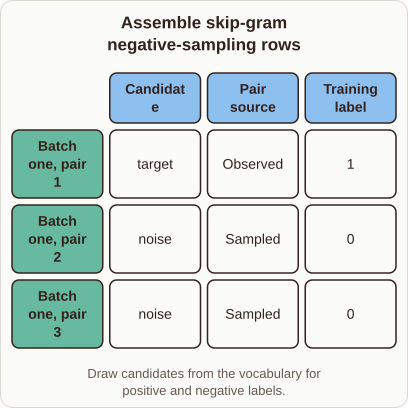
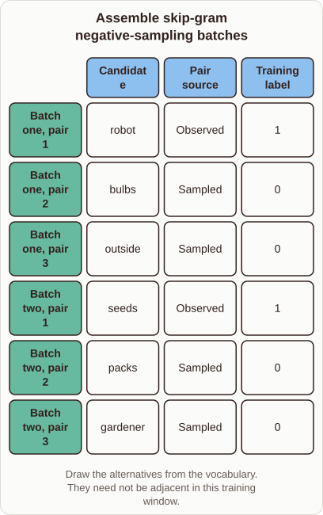

# Negative Sampling Training Rows in Word2vec

- Prompt (reference.prompts[0]): How does negative sampling make the actual training rows for Word2vec?
- Reference id: ml-word2vec-sampled-training-rows (source: Word2vec)
- Intended kind (reference.spec.diagram.kind): matrix
- Planner kind: sample-set (not fixed; offered sample-set | flow); planner routed to picture: no
- Model kind (first diagram): matrix; all diagrams: matrix
- Selector hit (intended reference among the references sent): yes
- References sent to the author (attempt 0): ml-word2vec-sampled-training-rows, ml-feature-store-architecture
- Structure (faithful-ref-v1, reference vs model spec): partly - The diagram is a matrix with the same columns. Its batch one rows match the reference's structure (Observed/1, then two Sampled/0). It leaves out batch two entirely, so it has only 3 of the 6 rows. It also uses generic candidates ("target", "noise") instead of specific words.
- Factual (factual-v2): 4/5, error no - Essentially correct; minor imprecision in the diagram subtitle, since positive pairs come from the corpus rather than being drawn from the vocabulary.
- Repaired: no; visual fallback: no; authored by google / gemini-3.5-flash-lite
- Time 3646 ms; author tokens in/out 3954/288; cost US$0.001907

| model (408 px) | reference (408 px) |
|---|---|
|  |  |

## Card body (as saved)

Word2vec uses negative sampling to turn large text corpuses into binary classification rows. For each observed context window, it takes one positive pair and draws a few random noisy words.

```rh-diagram
{"version":1,"diagram":{"title":"Assemble skip-gram negative-sampling rows","caption":"Draw candidates from the vocabulary for positive and negative labels.","kind":"matrix","columns":["Candidate","Pair source","Training label"],"rows":[{"heading":"Batch one, pair 1","cells":["target","Observed","1"]},{"heading":"Batch one, pair 2","cells":["noise","Sampled","0"]},{"heading":"Batch one, pair 3","cells":["noise","Sampled","0"]}]}}
```

The observed pair gets a label of $1$ because it actually appeared together in the text. The drawn noise words get labels of $0$ to teach the model what not to predict.
