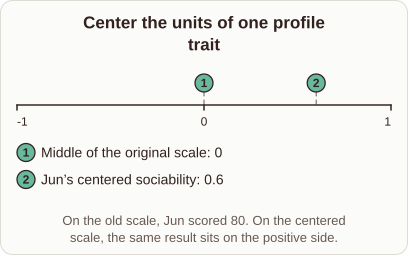

# Rescaling Personality Scores in Embedding Coordinates

- Prompt (reference.prompts[0]): How does rescaling a personality score help explain embedding coordinates?
- Reference id: ml-word2vec-trait-rescale (source: Word2vec)
- Intended kind (reference.spec.diagram.kind): number-line
- Planner kind: transformation (not fixed; offered transformation | coordinate-plot); planner routed to picture: no
- Model kind (first diagram): number-line; all diagrams: number-line
- Selector hit (intended reference among the references sent): yes
- References sent to the author (attempt 0): shape-transformation, ml-word2vec-trait-rescale
- Structure (faithful-ref-v1, reference vs model spec): fully - The diagram matches the reference: a number line from -1 to 1 with markers at 0 (middle of the original scale) and 0.6 (Jun's centered sociability), plus the same caption.
- Factual (factual-v2): 4/5, error no - Mostly correct; 'ensuring distances reflect true semantic relationships' is an overstatement, since rescaling only equalizes trait ranges.
- Repaired: no; visual fallback: no; authored by google / gemini-3.5-flash-lite
- Time 4876 ms; author tokens in/out 3839/429; cost US$0.002225

| model (408 px) | reference (408 px) |
|---|---|
|  |  |

## Card body (as saved)

Rescaling personality scores aligns their units with vector embedding spaces, ensuring that distances reflect true semantic relationships.

```rh-diagram
{"version":1,"diagram":{"title":"Center the units of one profile trait","caption":"On the old scale, Jun scored 80. On the centered scale, the same result sits on the positive side.","kind":"number-line","min":-1,"max":1,"markers":[{"value":0,"label":"Middle of the original scale"},{"value":0.6,"label":"Jun's centered sociability"}]}}
```

When raw scores have different ranges, certain dimensions dominate the distance metrics. Centering and scaling bring all traits to a comparable range, such as between $-1$ and $1$.

This transformation prevents any single trait from skewing the latent space coordinates.
