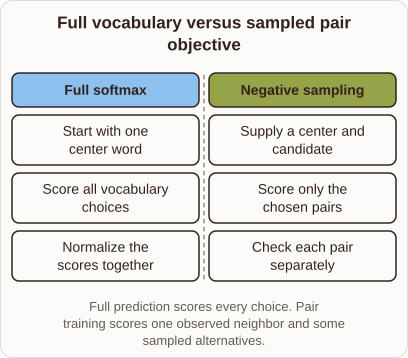

# Why Word2vec Replaces Full Softmax with Scoring Pairs

- Prompt (reference.prompts[0]): Why does Word2vec replace full softmax with scoring a few pairs?
- Reference id: ml-word2vec-vocabulary-versus-pair (source: Word2vec)
- Intended kind (reference.spec.diagram.kind): comparison
- Planner kind: comparison (not fixed; offered comparison | bar-chart); planner routed to picture: no
- Model kind (first diagram): comparison; all diagrams: comparison
- Selector hit (intended reference among the references sent): yes
- References sent to the author (attempt 0): shape-comparison, ml-word2vec-vocabulary-versus-pair, softmax-probabilities
- Structure (faithful-ref-v1, reference vs model spec): fully - The diagram's text is identical to the reference. It is a comparison with the same two columns, the same items under each, the same title and the same caption.
- Factual (factual-v2): 4/5, error no - Minor imprecision: 'every word vector depends on all other vectors' is loose; the cost is that the gradient touches all output vectors.
- Repaired: no; visual fallback: no; authored by google / gemini-3.5-flash-lite
- Time 5383 ms; author tokens in/out 3906/465; cost US$0.002335

| model (408 px) | reference (408 px) |
|---|---|
|  |  |

## Card body (as saved)

Calculating a full softmax over millions of words requires summing scores across the entire vocabulary for every single training step.

This normalization denominator makes updates computationally expensive because every word vector depends on all other vectors.

```rh-diagram
{"version":1,"diagram":{"title":"Full vocabulary versus sampled pair objective","caption":"Full prediction scores every choice. Pair training scores one observed neighbor and some sampled alternatives.","kind":"comparison","columns":[{"heading":"Full softmax","items":["Start with one center word","Score all vocabulary choices","Normalize the scores together"]},{"heading":"Negative sampling","items":["Supply a center and candidate","Score only the chosen pairs","Check each pair separately"]}]}}
```

Negative sampling avoids this cost by turning the multi-class problem into independent binary logistic regressions.

Instead of scoring every vocabulary item, the model scores the true target word alongside a few random negative samples.
