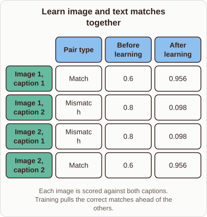

# Learning Image and Text Matches Together

- Prompt (reference.prompts[0]): How does CLIP training make matching image and text embeddings more similar?
- Reference id: ml-stable-diffusion-clip-contrastive-scores (source: Stable Diffusion)
- Intended kind (reference.spec.diagram.kind): matrix
- Planner kind: transformation (not fixed; offered transformation | flow); planner routed to picture: no
- Model kind (first diagram): matrix; all diagrams: matrix
- Selector hit (intended reference among the references sent): yes
- References sent to the author (attempt 0): shape-transformation, ml-stable-diffusion-clip-contrastive-scores, ml-feature-store-architecture
- Structure (faithful-ref-v1, reference vs model spec): fully - The diagram's matrix has the same title, columns, rows, cell values and caption as the reference, so it shows the full structure.
- Factual (factual-v2): 4/5, error no - Minor wording: mismatched pairs are pushed apart, not 'pulled' apart; otherwise accurate.
- Repaired: yes (other: explanation_bad_diagram: the rh-diagram spec is not valid (diagram.rows.0.id: Select layout teaching); visual fallback: no; authored by google / gemini-3.5-flash-lite
- Time 7150 ms; author tokens in/out 8658/1122; cost US$0.005403

| model (408 px) | reference (408 px) |
|---|---|
|  |  |

## Card body (as saved)

CLIP trains image and text encoders simultaneously to align their vector spaces. It computes cosine similarities for all pairs in a batch, forming a joint matrix.

```rh-diagram
{"version":1,"diagram":{"title":"Learn image and text matches together","caption":"Each image is scored against both captions. Training pulls the correct matches ahead of the others.","kind":"matrix","columns":["Pair type","Before learning","After learning"],"rows":[{"heading":"Image 1, caption 1","cells":["Match","0.6","0.956"]},{"heading":"Image 1, caption 2","cells":["Mismatch","0.8","0.098"]},{"heading":"Image 2, caption 1","cells":["Mismatch","0.8","0.098"]},{"heading":"Image 2, caption 2","cells":["Match","0.6","0.956"]}]}}
```

A contrastive loss function then pushes matching pairs together while pulling mismatched pairs apart. This updates both encoders so true pairings yield high dot products.
