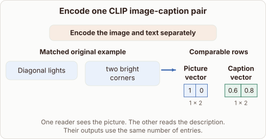

# Why CLIP Uses Separate Encoders

- Prompt (reference.prompts[0]): Why does CLIP have separate encoders for the picture and caption?
- Reference id: ml-stable-diffusion-clip-two-encoders (source: Stable Diffusion)
- Intended kind (reference.spec.diagram.kind): transformation
- Planner kind: block-stack (not fixed; offered block-stack | comparison); planner routed to picture: no
- Model kind (first diagram): picture; all diagrams: none
- Selector hit (intended reference among the references sent): yes
- References sent to the author (attempt 0): shape-block-stack, ml-stable-diffusion-clip-two-encoders
- Structure (faithful-ref-v1, reference vs model spec): none
- Factual (factual-v2): 5/5, error no
- Repaired: no; visual fallback: no; authored by google / gemini-3.5-flash-lite
- Time 6756 ms; author tokens in/out 3882/246; cost US$0.00878

| model (408 px) | reference (408 px) |
|---|---|
|  |  |

## Card body (as saved)

CLIP uses separate encoders because images and text are fundamentally different modalities. Each encoder processes its own data type into comparable vectors.

```rh-illustration
{"version":1,"id":"pic-1","prompt":"Two distinct neural network branches taking an image and text and outputting vectors","alt":"Illustration showing separate image and text encoders producing comparable vectors.","caption":"Separate encoders map different modalities into one shared space."}
```

This separation allows each modality to use the right architecture before their outputs align in a shared embedding space.
