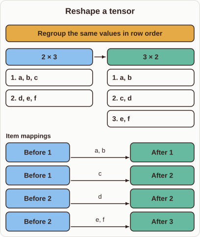
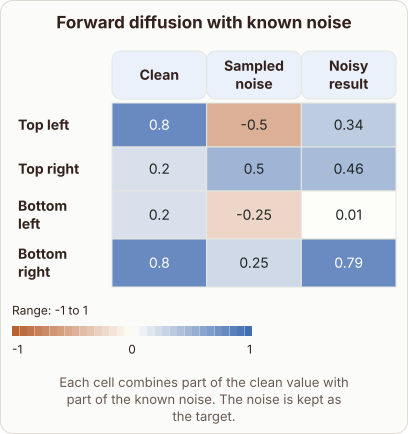

# Forward Diffusion Noise Addition

- Prompt (reference.prompts[0]): Can you show the numbers when forward diffusion adds known noise to a latent?
- Reference id: ml-stable-diffusion-forward-noise (source: Stable Diffusion)
- Intended kind (reference.spec.diagram.kind): heatmap
- Planner kind: transformation (not fixed; offered transformation | waterfall); planner routed to picture: no
- Model kind (first diagram): transformation; all diagrams: transformation
- Selector hit (intended reference among the references sent): yes
- References sent to the author (attempt 0): shape-transformation, ml-stable-diffusion-forward-noise
- Structure (faithful-ref-v1, reference vs model spec): not - The reference is a heatmap of forward diffusion with Clean, Sampled noise and Noisy result columns. The diagram instead shows a tensor reshape from 2×3 to 3×2, which has none of that structure.
- Factual (factual-v2): 4/5, error no - The prose is accurate. The reshape diagram is unrelated to diffusion, and its last line 'a, b | c | d | e, f' is garbled, but this looks like a layout artifact rather than a factual claim.
- Repaired: no; visual fallback: no; authored by google / gemini-3.5-flash-lite
- Time 3233 ms; author tokens in/out 3921/484; cost US$0.002387

| model (408 px) | reference (408 px) |
|---|---|
|  |  |

## Card body (as saved)

Forward diffusion scales clean latents and adds sampled noise to form new states. This transformation maps initial clean values to corrupted outputs.

```rh-diagram
{"version":1,"diagram":{"title":"Reshape a tensor","kind":"transformation","before":{"label":"2 × 3","items":["a, b, c","d, e, f"]},"after":{"label":"3 × 2","items":["a, b","c, d","e, f"]},"operation":"Regroup the same values in row order","links":[{"from":0,"to":0,"label":"a, b"},{"from":0,"to":1,"label":"c"},{"from":1,"to":1,"label":"d"},{"from":1,"to":2,"label":"e, f"}]}}
```

The operation blends clean signals with noise coefficients. Each step reduces the clean signal proportion while introducing more random variations.
