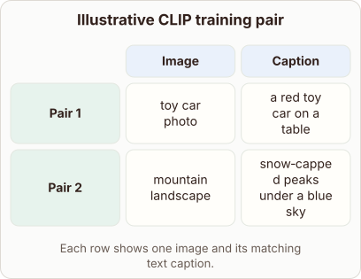
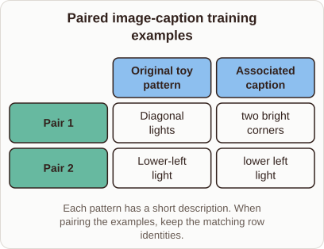

# Image‑caption pairs in CLIP training

- Prompt (reference.prompts[0]): What does an image and caption pair look like in CLIP training data?
- Reference id: ml-stable-diffusion-image-caption-pairs (source: Stable Diffusion)
- Intended kind (reference.spec.diagram.kind): matrix
- Planner kind: sample-set (fixed); planner routed to picture: no
- Model kind (first diagram): matrix; all diagrams: matrix
- Selector hit (intended reference among the references sent): yes
- References sent to the author (attempt 0): ml-stable-diffusion-image-caption-pairs, ml-feature-store-architecture
- Structure (faithful-ref-v1, reference vs model spec): fully - The diagram is a matrix with two columns (image and caption) and two rows, Pair 1 and Pair 2. Each row pairs an image with its matching caption, which is the reference structure. Only the wording and examples differ.
- Factual (factual-v2): 3/5, error yes - CLIP cannot generate captions for new pictures. It is a contrastive model with an image encoder and a text encoder, and it has no text decoder. It supports retrieval and zero-shot classification, not caption generation. The claim of 'millions of pairs' is also an understatement, since CLIP used about 400 million.
- Repaired: yes (visual marker / layout, visual marker / layout, visual marker / layout); visual fallback: no; authored by fireworks / accounts/fireworks/models/gpt-oss-120b
- Time 17445 ms; author tokens in/out 29857/1728; cost US$0.022326

| model (408 px) | reference (408 px) |
|---|---|
|  |  |

## Card body (as saved)

CLIP learns by aligning a single image with a short natural‑language caption. The model encodes both modalities, then adjusts weights so that matching pairs have high similarity while mismatched pairs do not.

This alignment, repeated over millions of pairs, creates a shared embedding space that can retrieve images from text or generate captions for new pictures.

```rh-illustration
{"version":1,"id":"pic-1","prompt":"A realistic photograph of a red toy car on a table, viewed from above, with natural lighting.","alt":"Shows the visual side of a training pair.","caption":"Notice the clear object that the caption will describe."}
```

The training loss compares each correct pair against many distractors, forcing the correct match to stand out. Because captions are free‑form sentences, CLIP captures rich semantics beyond simple labels.

```rh-diagram
{"version":1,"diagram":{"title":"Illustrative CLIP training pair","caption":"Each row shows one image and its matching text caption.","kind":"matrix","layout":"teaching","columns":["Image","Caption"],"rows":[{"id":"pair-1","heading":"Pair 1","cells":["toy car photo","a red toy car on a table"]},{"id":"pair-2","heading":"Pair 2","cells":["mountain landscape","snow‑capped peaks under a blue sky"]}]}}
```

As training proceeds, the model becomes a versatile vision‑language system that generalizes to tasks it never saw during training.
