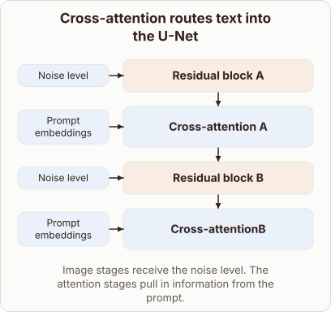

# Where do text prompt embeddings go inside the Stable Diffusion U-Net?

- Prompt (reference.prompts[0]): Where do text prompt embeddings go inside the Stable Diffusion U-Net?
- Reference id: ml-stable-diffusion-unet-text-attention (source: Stable Diffusion)
- Intended kind (reference.spec.diagram.kind): block-stack
- Planner kind: block-stack (fixed); planner routed to picture: no
- Model kind (first diagram): block-stack; all diagrams: block-stack
- Selector hit (intended reference among the references sent): yes
- References sent to the author (attempt 0): shape-block-stack, ml-stable-diffusion-unet-text-attention
- Structure (faithful-ref-v1, reference vs model spec): fully - The diagram has the same four-block sequence and the same inputs. Noise level feeds both residual blocks, and prompt embeddings feed both cross-attention blocks. The only difference is a spacing typo in "Cross-attentionB".
- Factual (factual-v2): 5/5, error no
- Repaired: no; visual fallback: no; authored by google / gemini-3.5-flash-lite
- Time 5557 ms; author tokens in/out 3829/619; cost US$0.002697

| model (408 px) | reference (408 px) |
|---|---|
|  |  |

## Card body (as saved)

Stable Diffusion injects text prompts directly into specific layers of the U-Net architecture.

While standard residual blocks process spatial image features conditioned on the noise level, cross-attention blocks integrate the text tokens.

```rh-diagram
{"version":1,"diagram":{"title":"Cross-attention routes text into the U-Net","caption":"Image stages receive the noise level. The attention stages pull in information from the prompt.","kind":"block-stack","blocks":[{"id":"b0","label":"Residual block A","role":"feedforward","inputs":[{"label":"Noise level"}]},{"id":"b1","label":"Cross-attention A","role":"attention","inputs":[{"label":"Prompt embeddings"}]},{"id":"b2","label":"Residual block B","role":"feedforward","inputs":[{"label":"Noise level"}]},{"id":"b3","label":"Cross-attentionB","role":"attention","inputs":[{"label":"Prompt embeddings"}]}]}}
```

Inside these attention layers, image feature maps provide the query vectors while the text prompt embeddings supply the key and value vectors.

This mechanism allows the model to align visual generation with the semantic guidance of the prompt at multiple resolutions.
