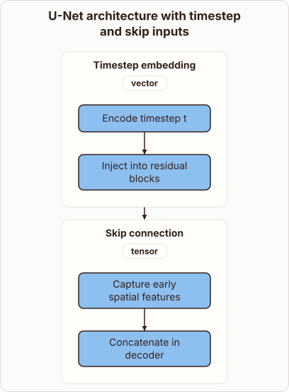
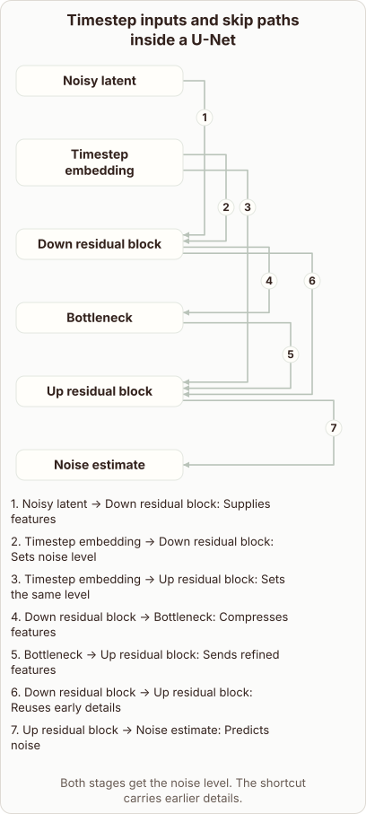

# Timestep Embeddings and Skip Connections in the U-Net

- Prompt (reference.prompts[0]): How do timestep embeddings and skip connections enter the Stable Diffusion U-Net?
- Reference id: ml-stable-diffusion-unet-timestep-and-skips (source: Stable Diffusion)
- Intended kind (reference.spec.diagram.kind): relationship
- Planner kind: block-stack (fixed); planner routed to picture: no
- Model kind (first diagram): block-stack; all diagrams: block-stack
- Selector hit (intended reference among the references sent): yes
- References sent to the author (attempt 0): shape-block-stack, ml-stable-diffusion-unet-timestep-and-skips
- Structure (faithful-ref-v1, reference vs model spec): not - The diagram lacks the reference graph. It has no noisy latent, down block, bottleneck, up block or noise estimate. It shows only a timestep embedding and a skip connection with generic notes, plus an unsupported "Timestep embedding → Skip connection" edge. The timestep-to-down/up edges and the down-to-up skip path are missing.
- Factual (factual-v2): 5/5, error no
- Repaired: yes (other: explanation_visual_unrelated: the diagram "Pack and inspect an order" names nothing from the questio); visual fallback: no; authored by google / gemini-3.5-flash-lite
- Time 5940 ms; author tokens in/out 8075/697; cost US$0.004166

| model (408 px) | reference (408 px) |
|---|---|
|  |  |

## Card body (as saved)

The U-Net architecture integrates noise levels through timestep embeddings. These embeddings inject the current $t$ into residual blocks to guide denoising.

```rh-diagram
{"version":1,"diagram":{"title":"U-Net architecture with timestep and skip inputs","kind":"block-stack","blocks":[{"id":"embed","label":"Timestep embedding","dims":"vector","diagram":{"kind":"flow","steps":["Encode timestep t","Inject into residual blocks"]}},{"id":"skip","label":"Skip connection","dims":"tensor","diagram":{"kind":"flow","steps":["Capture early spatial features","Concatenate in decoder"]}}]}}
```

Skip connections preserve spatial details by carrying features across from early downsampling stages directly to the corresponding upsampling blocks.
