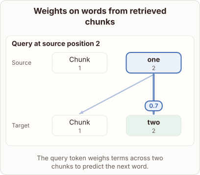
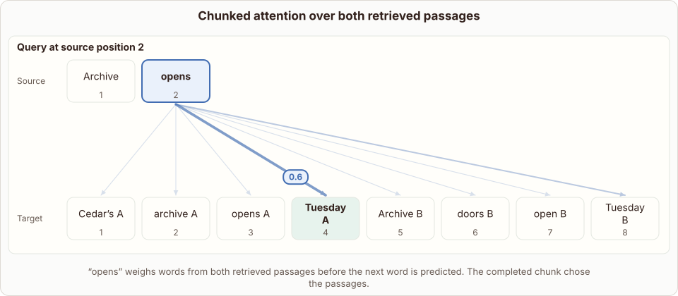

# Chunked Cross-Attention Weighting in RETRO

- Prompt (reference.prompts[0]): How does RETRO chunked cross-attention choose useful words from two retrieved passages?
- Reference id: figure-retro-chunk-attention (source: Retrieval Transformer)
- Intended kind (reference.spec.diagram.kind): token-links
- Planner kind: token-links (fixed); planner routed to picture: no
- Model kind (first diagram): token-links; all diagrams: token-links
- Selector hit (intended reference among the references sent): yes
- References sent to the author (attempt 0): shape-token-links, figure-retro-chunk-attention
- Structure (faithful-ref-v1, reference vs model spec): partly - The diagram is a token-links with one query linked to target tokens and weights summing to 1. But it has only 2 generic targets ("Chunk", "two") instead of 8 words from two passages A and B. It also lacks the "opens" query and the peaked weights on the Tuesday tokens. The two-passage structure is only loosely implied.
- Factual (factual-v2): 4/5, error no - Simplified: omits that tokens attend to neighbours retrieved for the previous chunk (causality); the 'two chunks' diagram is vague but not clearly wrong.
- Repaired: no; visual fallback: no; authored by google / gemini-3.5-flash-lite
- Time 3640 ms; author tokens in/out 3811/255; cost US$0.001781

| model (408 px) | reference (408 px) |
|---|---|
|  |  |

## Card body (as saved)

RETRO splits input text into chunks and retrieves matching passages from an external database to aid prediction.

When generating tokens, the model uses chunked cross-attention to focus on relevant words within these retrieved chunks.

```rh-diagram
{"version":1,"diagram":{"title":"Weights on words from retrieved chunks","caption":"The query token weighs terms across two chunks to predict the next word.","kind":"token-links","source":["Chunk","one"],"target":["Chunk","two"],"queries":[{"index":1,"weights":[0.3,0.7]}],"normalized":true}}
```

For each target token, attention weights are computed against the retrieved passage words. These weights determine which specific historical terms are most useful for the upcoming prediction.
