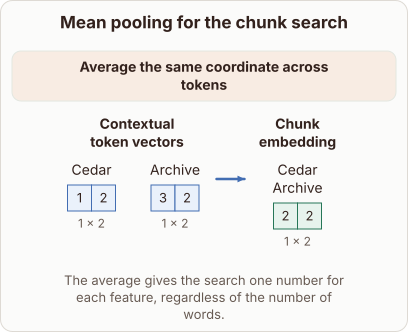

# Mean pooling for the chunk search in RETRO

- Prompt (reference.prompts[0]): How does RETRO average token vectors into one chunk embedding?
- Reference id: figure-retro-chunk-embedding (source: Retrieval Transformer)
- Intended kind (reference.spec.diagram.kind): transformation
- Planner kind: transformation (fixed); planner routed to picture: no
- Model kind (first diagram): transformation; all diagrams: transformation
- Selector hit (intended reference among the references sent): yes
- References sent to the author (attempt 0): shape-transformation, figure-retro-chunk-embedding, cosine-vector-directions
- Structure (faithful-ref-v1, reference vs model spec): fully - The diagram's description matches the reference exactly. It has the same before items (Cedar and Archive vectors), the same averaging operation, the same output chunk embedding (2, 2) and the same caption.
- Factual (factual-v2): 5/5, error no
- Repaired: no; visual fallback: no; authored by google / gemini-3.5-flash-lite
- Time 4475 ms; author tokens in/out 4118/615; cost US$0.002773

| model (408 px) | reference (408 px) |
|---|---|
|  |  |

## Card body (as saved)

RETRO pools tokens into a single chunk vector to query an external database efficiently.

```rh-diagram
{"version":1,"diagram":{"title":"Mean pooling for the chunk search","caption":"The average gives the search one number for each feature, regardless of the number of words.","kind":"transformation","before":{"label":"Contextual token vectors","items":[{"label":"Cedar","tensor":{"rows":1,"columns":2,"dimensions":"1 × 2","values":[1,2],"role":"input"}},{"label":"Archive","tensor":{"rows":1,"columns":2,"dimensions":"1 × 2","values":[3,2],"role":"input"}}]},"after":{"label":"Chunk embedding","items":[{"label":"Cedar Archive","tensor":{"rows":1,"columns":2,"dimensions":"1 × 2","values":[2,2],"role":"output"}}]},"operation":"Average the same coordinate across tokens"}}
```

It takes all contextual token vectors in a chunk and averages their values coordinate by coordinate across the entire sequence.

This mean pooling produces a fixed-size embedding that represents the whole chunk regardless of token count.
