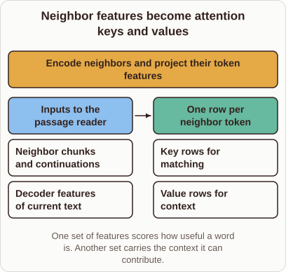
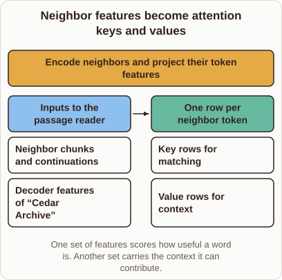

# How Retrieved Words Become Keys and Values in RETRO

- Prompt (reference.prompts[0]): How do the retrieved words become keys and values in RETRO?
- Reference id: figure-retro-encoded-neighbor-rows (source: Retrieval Transformer)
- Intended kind (reference.spec.diagram.kind): transformation
- Planner kind: flow (not fixed; offered flow | transformation); planner routed to picture: no
- Model kind (first diagram): transformation; all diagrams: transformation
- Selector hit (intended reference among the references sent): yes
- References sent to the author (attempt 0): shape-flow, figure-retro-encoded-neighbor-rows
- Structure (faithful-ref-v1, reference vs model spec): fully - The diagram has the same transformation structure as the reference. It has the same title, before items, operation, after items (key rows and value rows) and caption. The only difference is that "Decoder features of current text" replaces "Decoder features of 'Cedar Archive'", which is a wording change.
- Factual (factual-v2): 5/5, error no
- Repaired: no; visual fallback: no; authored by google / gemini-3.5-flash-lite
- Time 3906 ms; author tokens in/out 3862/482; cost US$0.002364

| model (408 px) | reference (408 px) |
|---|---|
|  |  |

## Card body (as saved)

In RETRO, retrieved text chunks from an external database must be processed so the main language model can attend to them.

These neighbor chunks pass through an encoder to produce continuous representations for every token.

```rh-diagram
{"version":1,"diagram":{"title":"Neighbor features become attention keys and values","caption":"One set of features scores how useful a word is. Another set carries the context it can contribute.","kind":"transformation","before":{"label":"Inputs to the passage reader","items":["Neighbor chunks and continuations","Decoder features of current text"]},"after":{"label":"One row per neighbor token","items":["Key rows for matching","Value rows for context"]},"operation":"Encode neighbors and project their token features"}}
```

These encoded representations are then projected into two separate matrices: keys and values.

The key vectors determine how relevant a retrieved word is to the current generation step, while the value vectors supply the actual contextual information injected into the model layers.
