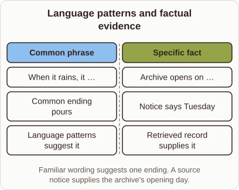
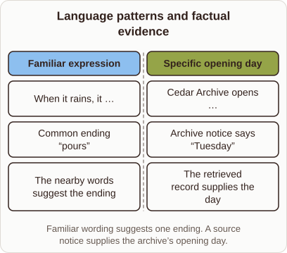

# Facts versus Common Phrases in Retrieval Models

- Prompt (reference.prompts[0]): Why would a retrieval model need a text store for facts but not common phrases?
- Reference id: figure-retro-fact-versus-pattern (source: Retrieval Transformer)
- Intended kind (reference.spec.diagram.kind): comparison
- Planner kind: comparison (not fixed; offered comparison | token-links); planner routed to picture: no
- Model kind (first diagram): comparison; all diagrams: comparison
- Selector hit (intended reference among the references sent): yes
- References sent to the author (attempt 0): shape-comparison, figure-retro-fact-versus-pattern
- Structure (faithful-ref-v1, reference vs model spec): fully - The diagram is a two-column comparison with the same title and caption. The common-phrase column covers the "pours" ending and language patterns suggesting it. The specific-fact column covers the Tuesday notice and the retrieved record supplying it. The wording is shortened but the structure matches.
- Factual (factual-v2): 5/5, error no
- Repaired: no; visual fallback: no; authored by google / gemini-3.5-flash-lite
- Time 3188 ms; author tokens in/out 3808/446; cost US$0.002258

| model (408 px) | reference (408 px) |
|---|---|
|  |  |

## Card body (as saved)

Language models store common phrases directly in their weights because such expressions occur frequently across training documents.

These patterns become internal associations that generate fluent text without external lookups.

```rh-diagram
{"version":1,"diagram":{"title":"Language patterns and factual evidence","caption":"Familiar wording suggests one ending. A source notice supplies the archive's opening day.","kind":"comparison","columns":[{"heading":"Common phrase","items":["When it rains, it …","Common ending pours","Language patterns suggest it"]},{"heading":"Specific fact","items":["Archive opens on …","Notice says Tuesday","Retrieved record supplies it"]}]}}
```

Specific facts, however, are rare and arbitrary. A model cannot internalize every unique detail, so it relies on a text store to fetch accurate evidence dynamically.
